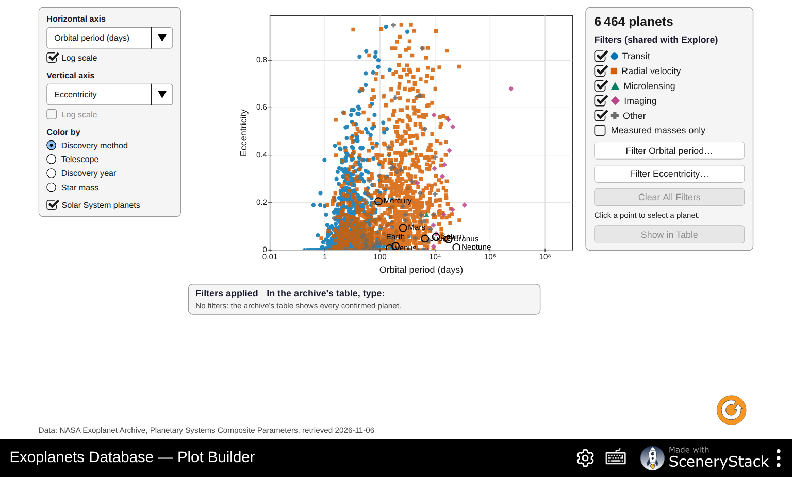
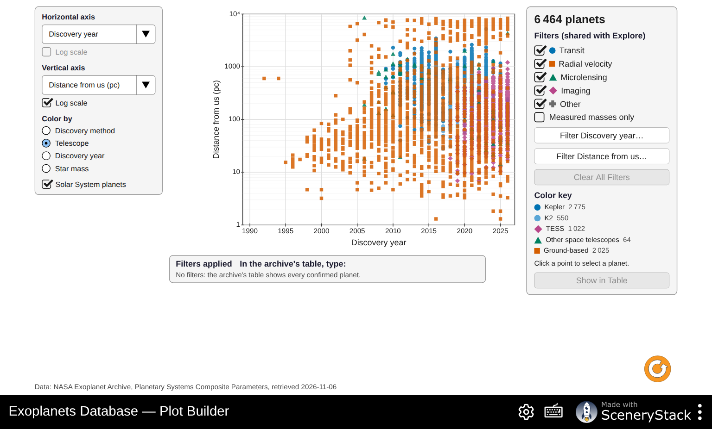

# Exoplanets Database: Answer Key and Instructor Notes

For the handout *Exoplanets Database: What the Archive Can and Cannot Tell Us*. Instructor use only.

The numbers come from the snapshot bundled in the simulation: NASA Exoplanet Archive,
Planetary Systems Composite Parameters, retrieved **2026-11-06**, with 6,464 confirmed planets.
They were computed with `handouts/tools/answers-exoplanetsdatabase.mjs`, which uses the
simulation's own groupings and inclusive filter bounds. I checked the headline tiles, the method
counts and the Sun-like-stars count (1,175) on screen.

Unlike the live archive, the snapshot does not change, so every group gets the same numbers. When
the snapshot is refreshed (`npm run fetch-data` in the sim), rerun the script.

This activity can be used instead of *Exploring Exoplanets with the NASA Exoplanet Archive*. Part 1
overlaps that handout's Parts 1–2 on purpose. The rest focuses on selection effects and population
plots.

## Suggested pacing (about 2 hours)

| Part | Time | If short on time |
|---|---|---|
| 0 Predictions | 5 min | Assign as pre-lab |
| 1 Counts | 15 min | Skip the "since 2020" column |
| 2 Who finds what? | 20 min | |
| 3 Hot Jupiters | 15 min | Keep: this is the key idea |
| 4 Sizes | 25 min | Skip Q12 or Q14 |
| 5 Kepler's third law | 15 min | Do only Q17 |
| 6 Plot Builder | 25 min | Q20 can be homework |
| 7 Putting it together | 5–10 min | |

## Part 0: Predictions

- P1: 6,464 in the snapshot; most found by transits (74 %). Students often guess hundreds, or guess radial velocity or "telescopes taking pictures".
- P2: most planets sit at small orbits (under 1 au), from Earth-size up to Jupiter-mass; Earth sits in a nearly empty region.
- P3: no. This is the selection effect of Part 3.

## Part 1: Counts

**Q1.** 6,464 confirmed · 4,813 TESS candidates · 1,977 Kepler candidates · 1,024 found by TESS · 2,787 found by Kepler.

**Q2.** A candidate is a signal (for example a repeating dip) that might be a planet but has not passed follow-up checks: more transits, a radial-velocity mass, or ruling out an eclipsing binary star in the background. Follow-up needs large telescopes and time, so a backlog builds up.

**Q3.** (a) 1.62 times the June 2019 count of 4,000. (b) Big jumps in 2014 and 2016: Kepler's statistical validation releases, when hundreds of candidates were confirmed together in single papers.

**Q4.**

| Method | All years | Since 2020 (2,368 planets) |
|---|---|---|
| Transit | 4,797 (74.2 %) | 1,659 (70.1 %) |
| Radial velocity | 1,205 (18.6 %) | 431 (18.2 %) |
| Microlensing | 292 (4.5 %) | 202 (8.5 %) |
| Imaging | 98 (1.5 %) | 45 (1.9 %) |
| Other | 72 (1.1 %) | 31 (1.3 %) |

(a) Transit. (b) Transits still dominate, though slightly less than before (Kepler's big releases are over; TESS continues). Microlensing's share has roughly doubled thanks to dedicated surveys (KMTNet, OGLE, MOA). Imaging is creeping up with better instruments and Gaia.

## Part 2: Who finds what?

**Q5.** The values span many factors of ten (masses from under 1 to over 10,000 Earth masses; distances from 0.01 to thousands of au). On a linear axis, almost every planet would be squashed into one corner. A log scale gives each factor of 10 the same space.

**Q6.**

| Method | Distance | Mass | Why |
|---|---|---|---|
| Transit | about 0.01–1 au | about 1 to 3000 | Close orbits line up more often and transit more often; the dip depends on size |
| Radial velocity | about 0.02–10 au | about 3 to 10,000 | Needs a big wobble (massive, close planets) and data covering at least one orbit |
| Microlensing | about 0.5–10 au | about 1 to 3000 | Sensitive near the "Einstein radius", a few au, around faint distant stars |
| Imaging | about 10–1000+ au | about 1000 and more | Only bright, young, massive planets far enough from the star's glare |

**Q7.** (a) Jupiter and Saturn lie among radial-velocity and microlensing planets. Earth and Venus sit in an almost empty region. Mercury and Mars are below all the methods, and Uranus and Neptune in a sparse one. (b) Jupiter (by radial velocity with a decade or more of data; also microlensing), possibly Saturn (decades of data). Not Earth, Venus, Mars or Mercury: too light for radial velocity at 1 m/s, and with transits only for a lucky alignment and very precise photometry; Earth would need years of data (see Transit Hunter). Uranus and Neptune: too faint and slow. (c) Not necessarily. Earth-mass planets at Earth-like distances give the smallest signals for every method, so the emptiness reflects what we can detect, not what exists. Kepler statistics suggest such planets are fairly common.

## Part 3: Hot Jupiters

**Q8.** Upper left: masses of about 100–3000 Earth masses at periods of about 1–10 days. They give the largest and fastest radial-velocity signals, so even 1990s instruments (about 10 m/s) found them in weeks.

**Q9.** (a) 1,175. (b) 111. (c) 111/1,175 ≈ 9.4 % pass the listed-value filters. With **Measured masses only**, 105 remain (8.9 % of 1,175). Across the whole archive, 662 of the 718 listed-value hot-Jupiter matches have measured central masses or RV minimum masses. An upper limit above 95 M⊕ does not show that the actual mass exceeds 95 M⊕.

**Q10.** (a) No. About 9 % of planets in the archive against about 1 % of stars: the archive over-represents hot Jupiters about tenfold. Note the comparison is not quite like for like: one counts planets, the other stars. (b) Any two:

- Their radial-velocity signal is huge (tens to hundreds of m/s) and repeats every few days.
- Their transit chance is about 10 %, against 0.5 % for Earth-like orbits.
- Their dips are deep (about 1 %), so even ground-based surveys like WASP and HAT find them.
- Short periods give many transits in a short survey.

(c) A selection effect is a bias in a sample that comes from how it was collected: easy-to-detect objects are over-represented, so the sample does not reflect the true population. (The occurrence rate of about 1 % is from Wright et al. 2012 for radial-velocity surveys, about 1.2 %; Kepler gives about 0.5 %.)

## Part 4: Sizes

**Q11.** Transit only; estimated (≈) radii included, as Explore counts them:

| Radius | 1.0–1.4 | 1.4–1.8 | 1.8–2.2 | 2.2–2.6 | 2.6–3.0 |
|---|---|---|---|---|---|
| Count | 577 | 657 | 542 | 671 | 513 |

(a) Two peaks, with a dip at 1.8–2.2 Earth radii: the **radius valley** (Fulton et al. 2017). In this composite table it is shallow, because radii from many papers with different precision blur it. With only the most precise radii it is much deeper. (b) Close-in small planets that started with thin hydrogen envelopes lose them to the young star's X-ray and ultraviolet light (photoevaporation) or to their own heat (core-powered mass loss). They shrink to bare rocky cores of about 1.5 Earth radii. Those that keep their envelopes stay above about 2 Earth radii. Few end up in between.

**Q12.**

| | Period 1–3 d | Period 10–30 d |
|---|---|---|
| Radius 3–6 (Neptunes) | 33 | 267 |
| Radius ≥ 8 (giants) | 239 | 107 |

Neptune-sized planets are rare on very short orbits, even though giants there are common and such planets would be easy to detect by transit. Something removes them, or prevents them from forming there: probably their atmospheres are stripped by the intense radiation, and they are not massive enough to hold on. Hence "desert".

**Q13.** (a) Examples: Kepler-10 b, 55 Cnc e, TRAPPIST-1 planets, K2-229 b: rock and iron. (b) Examples: GJ 1214 b, K2-18 b, Kepler-11 planets: a thick envelope of water or hydrogen and helium gas. (c) The radius stays near Jupiter's (about 11–13 Earth radii), or even shrinks slightly: extra mass compresses the gas more strongly (degenerate matter), so heavier giants are denser, not bigger.

**Q14.** 6,433 masses listed; 3,163 measured central values or RV minimum masses. (a) About 50.8 % are excluded: 3,270 / 6,433. Subtract 238 limits to obtain 3,032 estimated masses, or 47.1 %. The limits comprise 225 upper and 13 lower bounds. (b) Estimated masses were computed from the radius with an average relation. Plotting them would simply redraw that relation: circular reasoning. Only measured masses test it.

## Part 5: Kepler's third law

**Q15.** (a) On the 1 M☉ line. (b) A lighter star pulls less hard, so a planet at the same distance moves more slowly and takes longer to go around: a longer period for the same orbit size.

**Q16.**

| Planet | P (d) | P (yr) | a (au) | a³/P² | Table |
|---|---|---|---|---|---|
| TRAPPIST-1 e | 6.101 | 0.01670 | 0.02925 | 0.090 | 0.0898 |
| 51 Peg b | 4.231 | 0.01158 | 0.052 | 1.05 | 1.07 |
| nu Oph b | 529.9 | 1.451 | 1.765 | 2.61 | 2.61 |

The Star mass filter at most 0.1 lists 57 planets, including TRAPPIST-1 b–h. Sorted by year, the oldest planets are the PSR B1257+12 pulsar planets (1992), then 51 Peg b (1995). Star mass at least 2.5 lists nu Oph b and its sibling c.

**Q17.** Kepler-452 b: 0.6 % · Kepler-34 b: 49 % · Kepler-47 c: 26 % · Kepler-453 b: 17 %.

(a) Kepler-34 b, Kepler-47 c and Kepler-453 b are circumbinary planets: they orbit both stars of a binary. Others in the same list are TOI-1338 c (24 %) and BEBOP-3 b (19 %). (b) The planet orbits the combined mass of both stars, which is larger than the listed single-star mass. The real a³/P² is the total mass (for Kepler-47 c, about 1.3 M☉, against 0.96 in the table). Across all planets with P, a and M★ listed, 83 % agree within 10 %. Most large disagreements are binaries, eccentric or poorly measured orbits, or values from different papers mixed in the composite table.

## Part 6: Plot Builder

**Q18.** (a) Under about 5 days almost all orbits are circular (median e = 0; only about 1.2 % of plotted central values have e > 0.3). Beyond 1000 days eccentricities spread widely (median 0.22; 38 % have e > 0.3). (b) Yes. Tides raised on a close planet by its star dissipate energy and circularize the orbit over millions of years. Far planets feel weak tides, so they keep their eccentricities.

**Q19.** (a) Mostly within about 50 pc (median for radial velocity: 44 pc), from ground-based radial velocity. (b) Kepler: hundreds of parsecs (median 770 pc); TESS: about 100 pc (median 115 pc). (c) Closer stars are brighter, so their planets' atmospheres can be studied (JWST transmission spectra) and their masses measured by radial velocity. Kepler's stars are mostly too faint for this.

**Q20.** Grade on the claim–evidence–reasoning quality, not the conclusion. Things to look for:

- The axes chosen actually address the question.
- Log scales are used for wide ranges.
- The evidence cites the plot specifically (named planets, ranges, counts).
- The reasoning names a plausible selection effect. For example, giant planets around massive stars are found mostly by radial velocity around evolved giant stars; or the starlight a planet receives is partly estimated (≈) by the archive.

## Part 7: Putting it together

**Q21.** P1: 6,464, mostly transits. P2: most planets close in, with Earth in an empty region. P3: no, a selection effect (Q10).

**Q22.** Any two:

- Hot Jupiters are about 9 % of the archive but only about 1 % of stars have one (Q9–10).
- Earth-like planets are almost absent where every method is weakest (Q7).
- Distances follow the telescope used (Q19).
- About half the masses are estimated (Q14).
- Methods' regions on the mass–orbit plot match their sensitivity, not nature (Q6).

**Q23.** Examples:

- Earth-mass planets at about 1 au around Sun-like stars: the next generation of very precise radial velocity (about 10 cm/s), ESA's PLATO (transits of bright stars, launch about 2026) and NASA's Habitable Worlds Observatory (imaging).
- Cold giants and free-floating planets at 1–10 au: the Nancy Grace Roman Space Telescope's microlensing survey.
- Giants at 1–5 au around nearby stars: Gaia astrometry (data release 4).

Gaia's and Roman's regions will probably fill first because those surveys are already scheduled.

## Common misconceptions

- "The archive is a census." It is a list of what we can detect (Q10, Q22).
- "Empty region = no planets." Usually it means we cannot detect them yet (Q7).
- "Every listed mass was measured." About 47 % are estimated from radius and 238 values are upper/lower limits (Q14).
- "Kepler's law fails for some planets." It holds; the listed star mass is wrong for that orbit (Q17).
- "Log scales distort data." They show relative (factor) differences evenly (Q5).

## Note on spelling

The simulation's English labels were changed to American spelling on 2026-11-06 (pushed to `main`
and deployed), so the labels quoted in the handout match the live site.

The mass–radius gallery now uses a numerical pure-iron curve rather than extrapolating the
rocky-planet fit to pure iron. The water line is only a constant-density guide. Upper/lower
limits are omitted as plot coordinates, so plotted counts can be smaller than table matches.
To reproduce **Measured masses only** in the NASA archive, excluding calculated references
is not sufficient: also require `pl_bmasselim = 0` in TAP.
