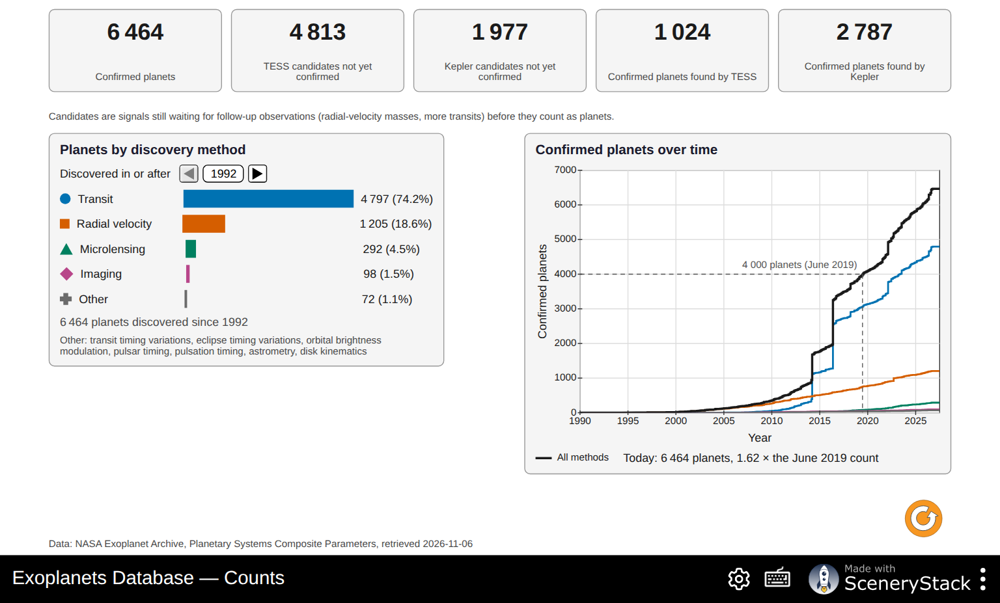
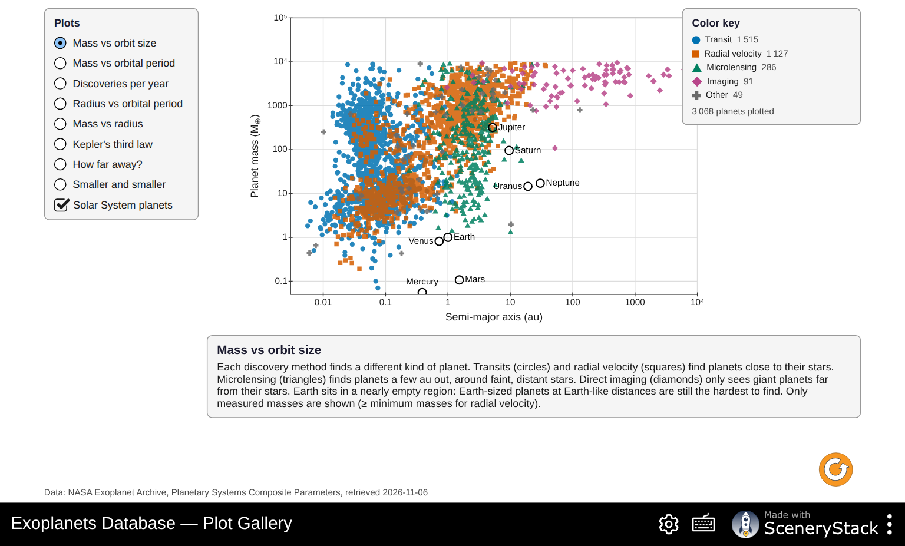
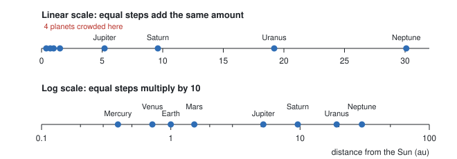
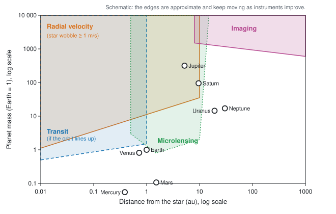
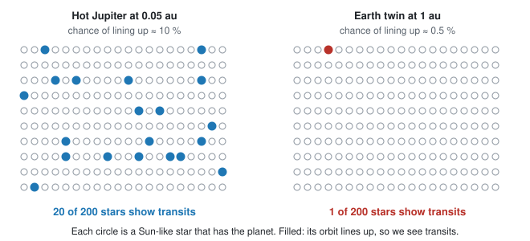
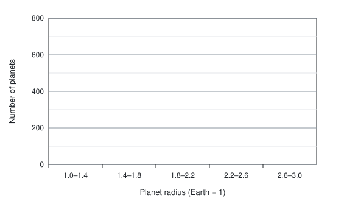
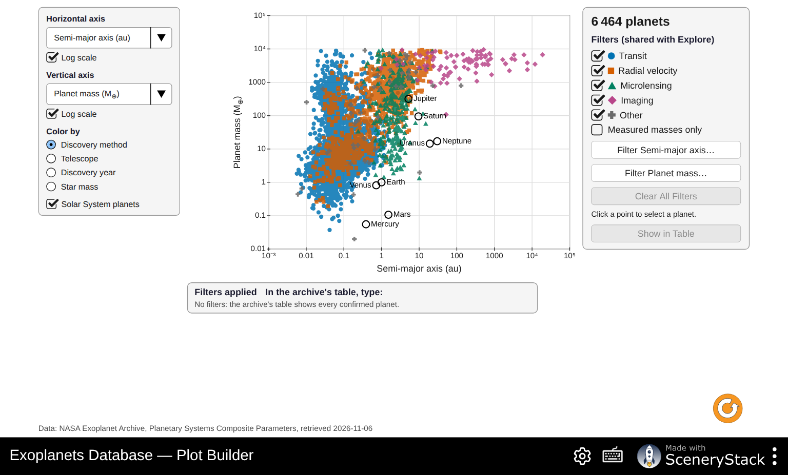

# Exoplanets Database: What the Archive Can and Cannot Tell Us

**Simulation:** Exoplanets Database, <https://openlyceum.github.io/ExoplanetsDatabase/> (works offline once loaded)

Names: ______________________________________________ Section: ________ Date: __________

## What you will learn

By the end of this activity you should be able to:

1. Read the NASA Exoplanet Archive's headline numbers and explain what they do and do not include.
2. Read population plots on log scales and name the main groups of known planets.
3. Explain how each detection method's strengths and blind spots shape the list of known planets (**selection effects**).
4. Use Kepler's third law and density across many planets, and spot values that do not fit.
5. Ask your own question of the data, make a plot that answers it, and support a claim with evidence.

The simulation holds a snapshot of the **NASA Exoplanet Archive**: every confirmed planet, with values combined from the best published measurements. A value marked **≈** was estimated by the archive, not measured. A mass marked **≥** is a lower bound, often a minimum mass from radial velocity. A value marked **≤** is an upper limit. These bounds are not measured central values. The gallery omits bounds on its axes; **Measured masses only** excludes both bounds and estimated masses.

## Tips for using the simulation

- **Explore** is a table. Press a column header to sort; press the funnel under it to filter (type "at least" and "at most" values). The count at the top tells you how many planets pass all filters.
- Filters in **Explore** and **Plot Builder** are shared. Press **Clear All Filters** before starting each new question.
- In plots, hover over or click a point to see which planet it is.
- Record the numbers you see. The archive grows every week, so your instructor's numbers may differ slightly from today's real archive.

---

## Part 0: Predictions

Answer these **before** you open the simulation.

**P1.** About how many planets outside the Solar System do you think are known? ______________ Which detection method do you think found the most? ______________

**P2.** Suppose you plotted every known planet's mass against its distance from its star. Where on the plot would you expect most planets to be? Where would Earth be: in a crowded region or an empty one?

  

**P3.** A friend says: "Most known exoplanets are giant planets very close to their stars, so that must be the most common kind of planet in the galaxy." Do you agree? Explain.

  

---

## Part 1: Counts (the big picture)

Open the **Counts** screen.

**1.** Record the headline numbers.

| Confirmed planets | TESS candidates not yet confirmed | Kepler candidates not yet confirmed | Confirmed planets found by TESS | Confirmed planets found by Kepler |
|---|---|---|---|---|
| | | | | |

**2.** Read the note under the numbers. What is the difference between a *candidate* and a *confirmed planet*? Why do you think thousands of candidates are still waiting?

  

**3.** Read the **Confirmed planets over time** chart.

a. By what factor has the count grown since June 2019? ______________

b. Describe two sudden jumps in the black line. In what years did they happen? ______________ What could cause hundreds of planets to be confirmed at once?

  

**4.** Fill in the table for all years (the earliest **Discovered in or after** year), then for planets discovered in or after 2020.

| Method | All years: count (%) | Since 2020: count (%) |
|---|---|---|
| Transit | | |
| Radial velocity | | |
| Microlensing | | |
| Imaging | | |
| Other | | |

a. Which method has found the most planets? Was P1 right?

b. Has the share of each method changed in recent years? Suggest a reason for one change.

  

---

## Part 2: Who finds what? (mass versus orbit size)

Open the **Plot Gallery** and choose **Mass vs orbit size**. Check **Solar System planets**.

Both axes use a **log scale**: each step multiplies by 10.

**5.** Why do astronomers use log scales for these plots? Use the diagram above and the range of masses on the plot (from less than 1 Earth mass to over 10,000).

  

**6.** Each method has its own marker shape. Describe where each method's planets sit.

| Method | Typical distance from star (au) | Typical mass (Earth = 1) | Why this method finds planets there |
|---|---|---|---|
| Transit (circles) | | | |
| Radial velocity (squares) | | | |
| Microlensing (triangles) | | | |
| Imaging (diamonds) | | | |

**7.** Compare the plot with the schematic above.

a. Which Solar System planets sit in a well-populated part of the plot? Which sit in nearly empty parts?

  

b. If an exact copy of our Solar System orbited a nearby star, which of its planets could today's methods detect? Which could they not? Explain.

  

c. Earth sits in a nearly empty region. Does this mean Earth-like planets are rare? Give another explanation.

  

---

## Part 3: Hot Jupiters and a selection effect

Choose **Mass vs orbital period**. Read the caption.

**8.** Where is the clump of "hot Jupiters"? Why were they the first planets found around Sun-like stars?

  

**9.** Go to **Explore** and count the hot Jupiters. We will call a planet a hot Jupiter if its listed mass is **at least 95** Earth masses (0.3 Jupiter masses) and its orbital period is **at most 10** days.

a. Press **Sun-like stars** (a quick filter). Planets around Sun-like stars: ______________

b. Now also filter the **Mass** column (at least 95) and the **Period** column (at most 10). Hot Jupiters around Sun-like stars: ______________

c. What percentage of the planets around Sun-like stars pass these listed-value filters? ______________ %. Check **Measured masses only** and record the revised hot-Jupiter count: ______________. Why can a mass upper limit not establish that a planet is massive?

**10.** Careful surveys that watched hundreds of Sun-like stars for years, whether or not they found planets, show that only about **1 star in 100** has a hot Jupiter.

a. Compare this with your percentage in question 9c. Is the archive a fair sample of planets? ______________

b. Use the diagram above and what you know about the radial-velocity method to give **two** reasons why hot Jupiters are over-represented in the archive.

   

c. This is called a **selection effect**. In your own words, what is a selection effect?

  

---

## Part 4: Sizes and what planets are made of

### The radius valley and the hot-Neptune desert

Press **Clear All Filters**. In **Explore**, leave only the **Transit** discovery method checked. Filter the **Radius** column with each range below and record the count.

**11.** Record the counts and draw a bar chart on the grid.

| Radius (Earth = 1) | 1.0 to 1.4 | 1.4 to 1.8 | 1.8 to 2.2 | 2.2 to 2.6 | 2.6 to 3.0 |
|---|---|---|---|---|---|
| Number of planets | | | | | |

a. Describe the shape of your bar chart. Is there a range of sizes with fewer planets than its neighbors? ______________

b. Planets smaller than about 1.5 Earth radii are mostly rocky ("super-Earths"). Planets bigger than about 2 Earth radii are mostly wrapped in gas ("sub-Neptunes"). Suggest an explanation for a gap between the two groups. (Hint: a planet close to a hot young star is blasted with radiation.)

  

**12.** Go back to the **Plot Gallery** and choose **Radius vs orbital period**. Read the caption, then test it in **Explore**. Press **Clear All Filters** first.

| Planets with radius 3 to 6 (Neptune-sized) | Period 1 to 3 days | Period 10 to 30 days |
|---|---|---|
| Count | | |

| Planets with radius at least 8 (giants) | Period 1 to 3 days | Period 10 to 30 days |
|---|---|---|
| Count | | |

What do the counts show? Why is the empty region called the "hot-Neptune desert"?

  

### Mass and radius together

**13.** Choose **Mass vs radius** in the gallery.

a. Find a planet near the "Earth-like rock" curve. Name: ______________ What is it probably made of?

b. Find a planet far above the rock curve with a mass under 20 Earth masses. Name: ______________ What must it have?

c. Above about 100 Earth masses, what happens to the radius as the mass increases? Why?

  

**14.** Press **Clear All Filters** in **Explore**. Filter the **Mass** column with **Hide planets with no value** checked. Count: ______________ Now check **Measured masses only**. Count: ______________

a. What fraction of listed masses are excluded by **Measured masses only**? ______________. This includes both estimated masses and limits. Of the 6,433 listed masses in this snapshot, 238 are limits; use this to find the fraction estimated from radius: ______________.

b. The archive estimates a missing mass from the radius, using an average mass–radius relation. Why would it be a mistake to use estimated masses to test whether planets follow a mass–radius relation?

  

---

## Part 5: Kepler's third law for every star

In convenient units, Kepler's third law is **P² = a³ / M★**, with P in years, a in au and M★ in solar masses. Turned around, it lets us **weigh a star**: **M★ = a³ / P²**.

**15.** In the **Plot Gallery**, choose **Kepler's third law**. Points are colored by the mass of the planet's star, and the lines show the law for stars of 0.1, 1 and 10 solar masses.

a. Where are the Solar System planets? ______________

b. Planets of small stars lie above the 1 M☉ line. Explain why, in your own words.

  

**16.** Weigh three stars. In **Explore**, find each planet (the filter is given), select it, and use its period and orbit size. Then compare with the star mass in the table.

| Planet | How to find it | P (days) | P (years) | a (au) | M★ = a³ / P² | M★ in the table |
|---|---|---|---|---|---|---|
| TRAPPIST-1 e | **Star mass** at most 0.1 | | | | | |
| 51 Peg b | sort by **Year**, oldest first | | | | | |
| nu Oph b | **Star mass** at least 2.5 | | | | | |

The planet card (right) also does this check: "Kepler's third law: P² = … , a³/M★ = … (…% apart)".

**17.** Press **Clear All Filters** and then the **Earth-like orbits** quick filter. Select each planet below and record how far apart the card says the two sides of Kepler's law are.

| Planet | % apart |
|---|---|
| Kepler-452 b | |
| Kepler-34 b | |
| Kepler-47 c | |
| Kepler-453 b | |

a. Three of these planets were found to orbit **two stars at once** (a binary star). Which three do you think they are? ______________

b. The table lists the mass of only one of the two stars. Explain why Kepler's law then seems not to work.

  

---

## Part 6: Plot Builder investigations

Open the **Plot Builder**. Choose any quantity for each axis, switch each axis to a **Log scale** or not, and use **Color by** to color the points by discovery method, telescope, discovery year or star mass.

**18.** Guided: **Eccentricity** (vertical, not log) against **Orbital period** (horizontal, log scale).

a. Describe how the spread of eccentricities changes from short to long periods.

  

b. Planets very close to their stars feel strong tides, which slowly make their orbits circular. Does the plot support this idea? Explain.

  

**19.** Guided: **Distance from us** (vertical, log scale) against **Discovery year** (horizontal). Under **Color by**, choose **Telescope**.

a. How far away were most planets found in the 1990s and 2000s? ______________ Which method was used?

b. Kepler (2009–2018) found planets mostly at what distances? ______________ TESS (since 2018)? ______________

c. Why does it matter for follow-up observations (for example with the James Webb Space Telescope) that TESS planets are closer to us?

  

**20.** Your own investigation. With your partner, choose a question the data can answer. Some ideas:

- Do bigger stars have bigger planets? (**Star mass** against **Planet mass**)
- Do hotter stars give their planets more starlight? (**Star temperature** against **Starlight received**)
- Are planets in systems with many planets smaller? (**Planets in system** against **Planet radius**)
- Which planets get about as much starlight as Earth, and how big are they? (**Starlight received** against **Planet radius**)

Question: ________________________________________________________________________

Horizontal axis: ______________ Log? ____ Vertical axis: ______________ Log? ____ Colored by: ______________ Filters used: ______________

Sketch your plot:

      

**Claim** (one sentence answering your question):

 

**Evidence** (what in the plot supports it; include numbers or named planets):

  

**Reasoning** (why the evidence supports the claim, and one way a selection effect could mislead you):

   

---

## Part 7: Putting it together

**21.** Go back to your predictions P1–P3. For each one, say whether you would change your answer, and why.

   

**22.** "The archive shows what planets are *easy to find*, not what planets are *common*." Give two pieces of evidence from today's activity that support this statement.

  

**23.** Look again at the empty regions of **Mass vs orbit size**. Choose one region and describe what kind of new telescope or method would fill it in. Which region do you think will fill first? Why?

  
