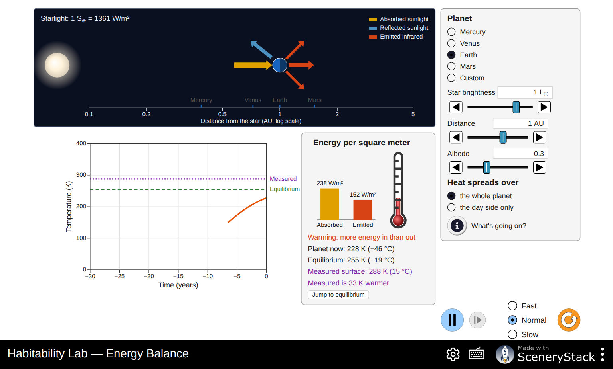
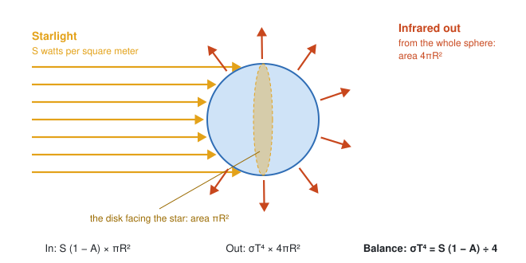
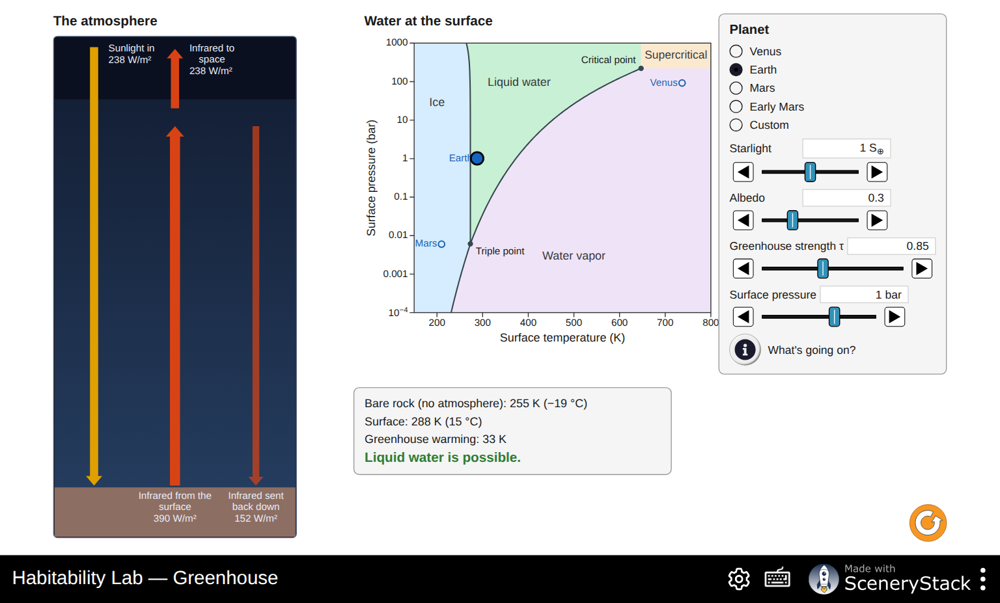
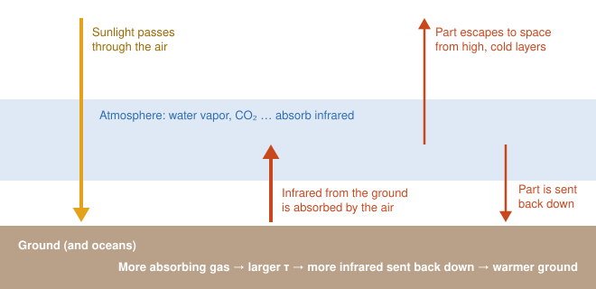
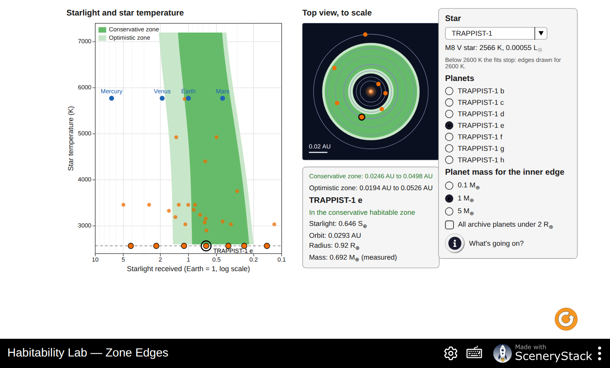
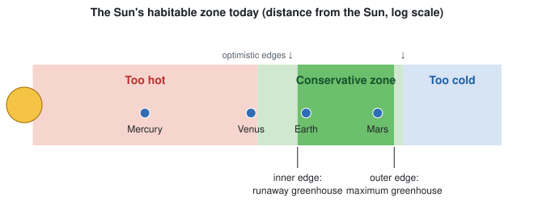
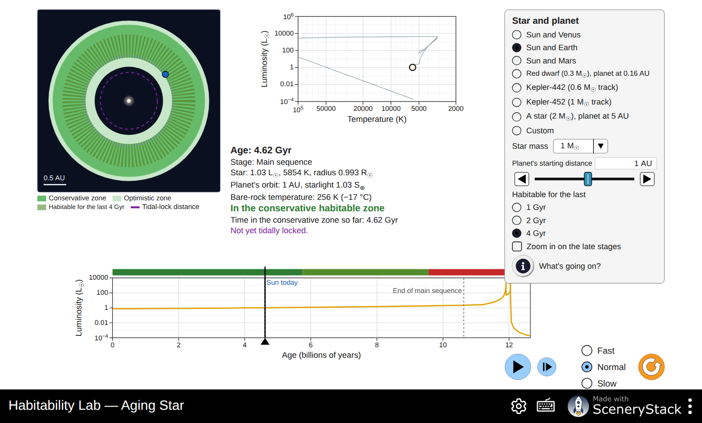
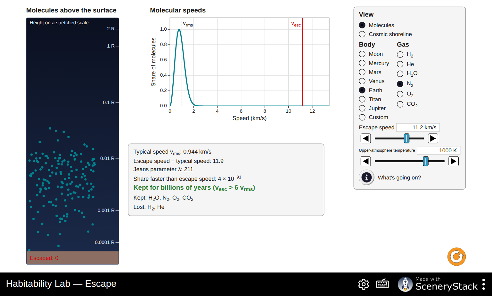
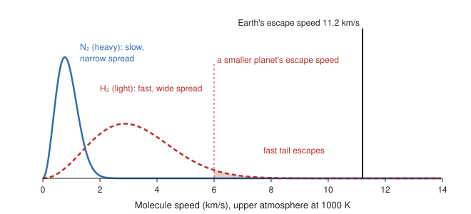
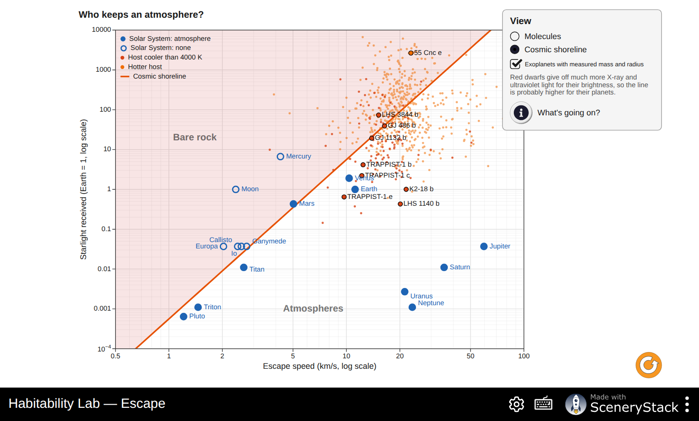

# Habitability Lab: What Makes a Planet Habitable?

**Simulation:** Habitability Lab, <https://openlyceum.github.io/HabitabilityLab/> (works offline once loaded)

Names: ______________________________________________ Section: ________ Date: __________

## What you will learn

By the end of this activity you should be able to:

1. Explain how a planet's temperature is set by the balance between the starlight it absorbs and the infrared it gives off, and how distance, the star's brightness and albedo change it.
2. Explain how a greenhouse atmosphere warms a surface, and why liquid water needs enough pressure as well as the right temperature.
3. Describe the edges of the habitable zone and how they depend on the star.
4. Explain how a star's habitable zone moves as the star ages, and why the star's lifetime matters for life.
5. Explain why some bodies keep their atmospheres and others lose them.
6. Combine all of these to judge whether a real exoplanet could have liquid water on its surface.

In this activity, **habitable** means *able to keep liquid water on its surface*. That is what astronomers can test from afar. It does not mean that life exists there.

A mass marked **≤** is an upper limit, not a measured mass. A mass marked **≥** may be a lower limit from radial velocity. Neither tells us the exact mass or density.

## Tips for using the simulation

- Each screen has a **What's going on?** button with a short explanation. Use it when you are stuck.
- To set a slider precisely, use the ◀ ▶ buttons beside it, or click the slider and hold **Shift** while pressing the arrow keys.
- Temperatures are in kelvin (K). Water freezes at 273 K (0 °C) and boils at 373 K (100 °C) at sea level on Earth.
- Starlight is given in units of what Earth receives from the Sun (S⊕ = 1 means "as much as Earth").

---

## Part 0: Predictions

Answer these **before** you open the simulation.

**P1.** List three things a planet needs in order to have liquid water on its surface.

  

**P2.** Earth's average surface temperature is about 288 K (15 °C). If Earth had no atmosphere at all, would its surface be warmer, colder or the same? Explain.

  

**P3.** A red dwarf is a star much dimmer than the Sun. To be as warm as Earth, should a planet orbit a red dwarf closer than 1 AU, farther, or at the same distance?

 

**P4.** The Sun slowly gets brighter as it ages. Will Earth stay habitable for as long as the Sun shines? Explain.

  

---

## Part 1: Energy Balance (a bare rock in starlight)

Open the **Energy Balance** screen. A planet with no atmosphere sits at some distance from its star. Arrows show the sunlight it absorbs, the sunlight it reflects and the infrared it gives off. The bars compare the energy absorbed and emitted per square meter.

**1.** With **Earth** selected, press play and watch the thermometer and the chart.

a. What happens to the **Absorbed** and **Emitted** bars as the planet warms? ______________

b. When does the temperature stop changing? ______________

c. About how many years does the planet take to get close to equilibrium? ______________ Why does it take years rather than seconds? (Hint: what on Earth stores a lot of heat?)

  

**2.** At equilibrium, read the starlight and the absorbed energy per square meter.

Starlight: ______________ W/m² Absorbed: ______________ W/m²

a. The albedo of 0.3 means that 30 % of the starlight is reflected. Show that 1361 × (1 − 0.3) ÷ 4 gives the absorbed value.

 

b. Use the diagram to explain where the "÷ 4" comes from.

  

**3.** Choose each planet and press **Jump to equilibrium**. Fill in the table.

| Planet | Distance (AU) | Albedo | Starlight (S⊕) | Equilibrium (K) | Measured surface (K) | Difference (K) |
|---|---|---|---|---|---|---|
| Mercury | | | | | | |
| Venus | | | | | | |
| Earth | | | | | | |
| Mars | | | | | | |

**4.** For which planets does the simple model work well? For which does it fail badly? What do the planets where it fails have that the others lack?

  

**5.** Choose **Earth**, then change only the **Albedo** and record the equilibrium temperature.

| Albedo | 0 | 0.3 | 0.7 | 0.9 |
|---|---|---|---|---|
| Equilibrium (K) | | | | |

a. Ice and snow have a high albedo. If an ice age covers more of Earth with ice, what happens to its temperature? What happens next? Explain why this is called a **feedback**.

  

**6.** Keep albedo 0.3 and a 1 L☉ star. Record the equilibrium temperature at each distance.

| Distance (AU) | 0.5 | 1 | 2 | 4 |
|---|---|---|---|---|
| Equilibrium (K) | | | | |

a. When the distance doubles, the temperature is multiplied by about ______________ . (Compare 1 → 2 and 2 → 4 AU.)

b. Why does the starlight fall off so quickly with distance? (Hint: S = L ÷ d².)

 

**7.** Set the **Star brightness** to 0.01 L☉, about a small red dwarf. Move the planet until its equilibrium temperature is back to about 255 K (Earth's value).

Distance: ______________ AU. Was your prediction P3 right? A star 100 times dimmer needs a planet ______________ times closer.

**8.** Choose **Mercury** and switch **Heat spreads over** to **the day side only**.

a. New equilibrium temperature: ______________ K. Why is it higher?

b. Which planets might not spread their heat around? (Think about a planet that always shows the same face to its star.)

  

---

## Part 2: Greenhouse (atmospheres and pressure)

Open the **Greenhouse** screen. The left panel shows an atmosphere with arrows for sunlight and infrared. The right panel is the **phase diagram of water**: for each surface temperature and pressure, it shows whether water is ice, liquid or vapor.

**9.** Choose **Earth**.

Bare rock (no atmosphere): ______________ K Surface: ______________ K Greenhouse warming: ______________ K

a. Read the arrows in the atmosphere panel. The ground gives off more infrared (______ W/m²) than leaves the top of the atmosphere (______ W/m²). Where does the difference go?

  

b. Was your prediction P2 right?

**10.** Keep the Earth settings and change only the **Greenhouse strength τ** (how strongly the atmosphere absorbs infrared).

| τ | none | 0.5 | 0.85 | 2 | 10 |
|---|---|---|---|---|---|
| Surface (K) | | | | | |
| Verdict for water | | | | | |

What would happen to Earth's oceans if its greenhouse effect became much stronger?

  

**11.** Choose **Venus**. τ = ______________ Surface pressure = ______________ bar Surface: ______________ K

a. Venus is farther from the Sun than Mercury, yet hotter. Explain using your table from Question 3.

 

b. Where is Venus on the phase diagram? What happens to water there?

 

**12.** Choose **Mars**. Surface pressure: ______________ bar

a. Where does the Mars dot sit compared with the **Triple point**? ______________

b. Raise τ until the surface is warmer than 273 K, without changing the pressure. Can liquid water exist? Why not?

  

**13.** Pressure matters. Choose **Earth**, then lower the **Surface pressure** while keeping the temperature at 288 K.

| Surface pressure (bar) | 1 | 0.1 | 0.01 | 0.001 |
|---|---|---|---|---|
| Verdict for water | | | | |

At about what pressure does liquid water stop being possible at 288 K? ______________ Why does water boil at a lower temperature when the pressure is lower? (Hint: think of cooking at high altitude.)

  

**14.** Choose **Early Mars** (Mars about 3.8 billion years ago, with a thick CO₂ atmosphere and a fainter young Sun).

a. Surface temperature: ______________ K Verdict: ______________

b. What τ would Early Mars need to reach 273 K? ______________

c. Geologists see dry river valleys and lake beds on Mars that are about 3.8 billion years old. What does this suggest about Mars's early atmosphere?

  

---

## Part 3: Zone Edges (the habitable zone)

Open the **Zone Edges** screen. The left diagram plots starlight received (horizontal, decreasing to the right) against the star's temperature. The dark green band is the **conservative** habitable zone and the light green bands extend it to the **optimistic** zone.

**15.** Choose **Sun (Solar System)** in the **Star** menu.

Conservative zone: ______________ to ______________ AU Optimistic zone: ______________ to ______________ AU

a. Where do Venus, Earth and Mars fall? ______________

b. Mars is inside the habitable zone, yet it has no liquid water today. Use what you found in Part 2 to explain why "in the habitable zone" does not guarantee liquid water.

  

c. Press **What's going on?** What happens to a planet at the inner edge (runaway greenhouse)? At the outer edge (maximum greenhouse)?

  

**16.** Choose **Any main-sequence star** and change the **Star temperature**.

| Star temperature (K) | Star type and luminosity (readout) | Conservative zone (AU) |
|---|---|---|
| about 3000 | | |
| about 4000 | | |
| about 5000 | | |
| 5772 (the Sun) | | |
| about 7000 | | |

a. How does the zone move as the star gets hotter and brighter? Was P3 right?

b. On the diagram, the zone tilts: around cool stars the edges sit at lower starlight. Read **What's going on?** and explain why.

  

**17.** Choose **TRAPPIST-1**, a very cool red dwarf with seven Earth-sized planets. Select each planet.

| Planet | Starlight (S⊕) | Zone status |
|---|---|---|
| TRAPPIST-1 b | | |
| TRAPPIST-1 c | | |
| TRAPPIST-1 d | | |
| TRAPPIST-1 e | | |
| TRAPPIST-1 f | | |
| TRAPPIST-1 g | | |
| TRAPPIST-1 h | | |

How many are in the conservative zone? ______________ Look at the scale bar of the top view. How does the size of this whole planetary system compare with Mercury's orbit (0.39 AU)?

 

**18.** The inner edge depends on the planet's mass. Choose **TOI-700**, select TOI-700 d, and switch **Planet mass for the inner edge** between 0.1, 1 and 5 M⊕. What changes, and why might a heavier planet tolerate more starlight?

  

**19.** Check two more systems and record their status.

| Planet | Star temperature (K) | Starlight (S⊕) | Radius (R⊕) | Zone status |
|---|---|---|---|---|
| Proxima Cen b | | | | |
| Kepler-452 b | | | | |
| K2-18 b | | | | |

K2-18 b is in the zone, but its radius is 2.4 R⊕. Using what you learned about planet sizes (Transit Hunter or Exoplanets Database), is it likely to be a rocky planet with oceans?

  

---

## Part 4: Aging Star (the zone moves)

Open the **Aging Star** screen. The top view shows the star, its zones and the planet. The timeline at the bottom shows the star's luminosity against age and a strip colored by the planet's status. Drag the age cursor on the timeline, or press play.

**20.** Choose **Sun and Earth** and move the age cursor to 0 (the young Sun).

a. Star luminosity: ______________ L☉ Bare-rock temperature: ______________ K

b. Rocks show that Earth had liquid oceans 4 billion years ago. With a bare-rock temperature this low, how could Earth have had liquid water? (Use Part 2.)

  

**21.** Move the age forward and record when Earth's status changes.

| Event | Age of the Sun (Gyr) |
|---|---|
| Earth leaves the conservative zone | |
| Earth becomes "too hot" | |
| The Sun leaves the main sequence | |

The Sun is 4.6 billion years old today. How long does Earth have left in the conservative zone? ______________ Was P4 right?

**22.** Choose **Sun and Venus**, then **Sun and Mars**.

a. When did Venus become "too hot"? ______________ Gyr, that is, ______________ billion years ago.

b. When did Mars enter the conservative zone? ______________ Gyr. Was Mars in it at the time of its river valleys (age about 0.8 Gyr)? Explain why this was a puzzle (the faint young Sun).

  

**23.** Compare three stars. For each preset, find how long the planet stays in the conservative zone and how long the star stays on the main sequence.

| Preset | Star mass (M☉) | Planet leaves the conservative zone at (Gyr) | End of main sequence (Gyr) |
|---|---|---|---|
| Red dwarf, planet at 0.16 AU | 0.3 | | |
| Sun and Earth | 1 | | |
| A star, planet at 5 AU | 2 | | |

a. The universe is 13.8 billion years old. Which of these stars has already died somewhere, and which has never died anywhere?

b. On Earth, complex life took about 4 billion years to appear. Around which kinds of stars could that happen?

  

**24.** Planets close to small stars become **tidally locked**: one side always faces the star, as the Moon always shows Earth the same face.

a. Choose the red dwarf preset (0.3 M☉, planet at 0.16 AU) and move to an age of about 10 Gyr. Is the planet inside the dashed **Tidal-lock distance** circle? ______________

b. Read the estimated locking age in the status below the star information. About ______________ Myr = ______________ Gyr. Can you read such an early event precisely from a timeline spanning hundreds of billions of years?

c. TRAPPIST-1 e orbits about five times closer to its star, and it would be locked within roughly 6,000 years in this Earth-like estimate. Why does being close to a star make locking so much faster?

 

d. Use Question 8 to describe the climate of a tidally locked planet. Why might winds or a thick atmosphere help?

  

---

## Part 5: Escape (keeping an atmosphere)

Open the **Escape** screen. Gas molecules move at a spread of speeds. The fastest can escape into space if they are faster than the body's **escape speed**.

**25.** Choose **Earth**. For each gas, record the typical speed, the ratio "escape speed ÷ typical speed" and whether it is kept.

| Gas | H₂ | He | H₂O | N₂ | O₂ | CO₂ |
|---|---|---|---|---|---|---|
| Typical speed (km/s) | | | | | | |
| Escape ÷ typical | | | | | | |
| Kept or lost? | | | | | | |

a. What rule does the simulation use to decide "kept for billions of years"? ______________

b. Earth's air contains almost no hydrogen or helium. Explain why.

  

**26.** Choose the **Moon**.

a. Which gases does the Moon keep? ______________

b. The Moon's escape speed is ______________ km/s. Why does it have no atmosphere?

**27.** Choose **Titan**, Saturn's largest moon. Its escape speed (2.64 km/s) is close to the Moon's (2.38 km/s), but Titan has a thick nitrogen atmosphere.

a. Which gases does Titan keep? ______________

b. What makes the difference? (Look at the temperature.)

 

**28.** Choose **Mars**. According to this model, Mars keeps N₂, H₂O and CO₂, yet today its atmosphere is very thin. Read **What's going on?** How else can a planet lose its air?

  

**29.** Switch the **View** to **Cosmic shoreline**. Solar System bodies with atmospheres (filled) and without (open) are separated approximately by a line. Exoplanet dots require measured masses and radii; upper mass limits do not determine an escape speed.

a. What two things decide on which side of the line a body sits? ______________

b. Which Solar System body sits closest to the line? ______________

c. Find TRAPPIST-1 b and c. The JWST telescope found no thick atmosphere on either. What does that suggest about where the line lies for planets of red dwarfs? Why? (Read the note in the panel.)

  

d. Where is TRAPPIST-1 e compared with the line?

 

---

## Part 6: A habitability scorecard

**30.** Choose **one** planet: TRAPPIST-1 e, Proxima Cen b, LHS 1140 b, Kepler-442 b or Kepler-452 b. Use every screen to fill in the scorecard. In the last column, write ✓ (good for liquid water), ✗ (bad) or ? (unknown).

Planet: ______________

| Question | Evidence (screen and values) | ✓ ✗ ? |
|---|---|---|
| Does it get the right amount of starlight? (Zone Edges) | | |
| Is it likely rocky, not a gas-rich sub-Neptune? (radius, mass) | | |
| How long will its star keep it in the zone? (Aging Star, closest track) | | |
| Is it tidally locked? (Aging Star) | | |
| Can it hold an atmosphere? (Escape: cosmic shoreline) | | |
| Does it need a greenhouse effect to be warm enough? (Energy Balance, Greenhouse) | | |

Overall verdict, and **the one measurement** you would most like a telescope like JWST to make next:

   

---

## Part 7: Putting it together

**31.** Go back to your predictions P1–P4. For each one, say whether you would change your answer, and why.

   

**32.** "Being in the habitable zone" and "being habitable" are not the same thing. Give two examples from today's activity that show the difference.

  

**33.** If you were choosing stars to search for a second Earth, would you choose red dwarfs, Sun-like stars or hotter A stars? Give one advantage and one drawback of your choice, using at least two screens.

  
