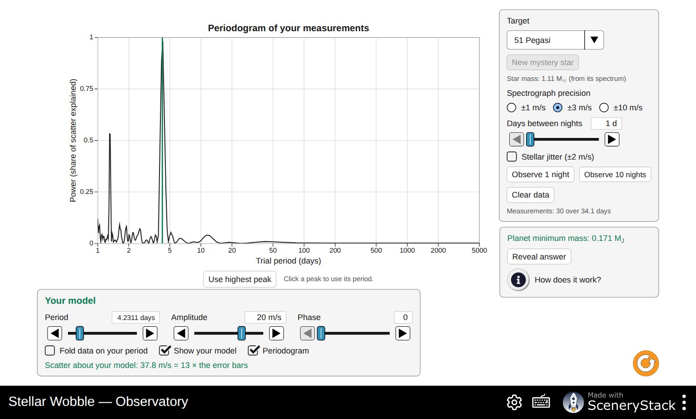
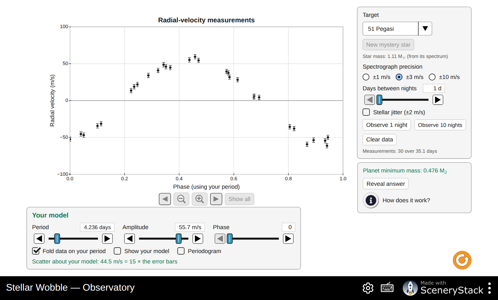

# Stellar Wobble: Answer Key and Instructor Notes

For the handout *Stellar Wobble: Weighing a Planet You Cannot See*. Instructor use only.

Numbers come from the simulation's own formulas (`StellarWobble/doc/model.md`), recomputed with
`handouts/tools/answers-stellarwobble.mjs`. Observatory values were checked in the simulation: 51 Pegasi
gave a minimum mass of 0.476 M_J at P = 4.236 d and K = 55.7 m/s. Students read 2–3 significant
figures, so accept values within a few percent. On the Wobble screen the sliders are logarithmic, so
"about 2 M_J" may read 1.95 or 2.04. Grade the pattern, not the third digit.

## Suggested pacing (about 2 hours)

| Part | Time | If short on time |
|---|---|---|
| 0 Predictions | 5–10 min | Assign as pre-lab |
| 1 Doppler | 25 min | Skip Q5 |
| 2 Wobble | 30 min | Keep only rows 1, 2, 4, 6 of the Q11 table |
| 3 Viewing Angle | 20 min | Skip Q19 |
| 4 Observatory | 35 min | Skip the mystery star (Q29) or set it as homework |
| 5 Putting it together | 10 min | Q31 and Q33 are the most important |

## Part 0: Predictions

No grading for correctness. Common answers to watch for later:

- P1: "planets are too small or far away" is only half the story. The key point is that the star is about a billion times brighter than the planet in visible light, and the two are very close together on the sky.
- P2: many students say the star does not move. Part 2 corrects this.
- P4: most students guess "yes". Q18 shows it is "no".

## Part 1: Doppler

**Q1.** (a) Away from Earth (+ means away). (b) Spread out: the star moves away from the waves heading toward Earth. (c) Toward longer wavelengths: a redshift. Students often say the waves "behind" are bunched. Point to the bottom half of the picture.

**Q2.** Δλ = λ v/c with c = 299,792 km/s. The simulation prints two significant figures.

| v (km/s) | Δλ Hβ (nm) | Δλ Hα (nm) | Shift |
|---|---|---|---|
| +100 | +0.16 | +0.22 | redshift |
| +300 | +0.49 | +0.66 | redshift |
| −50 | −0.081 | −0.11 | blueshift |
| −200 | −0.32 | −0.44 | blueshift |
| 0 | 0 | 0 | none |

**Q3.** (a) Hα shifts more (longer wavelength). (b) 0.16/486.13 ≈ 3.3 × 10⁻⁴ and 0.22/656.28 ≈ 3.4 × 10⁻⁴. (c) 100/300,000 = 3.3 × 10⁻⁴. (d) "…the same **fraction** of its wavelength", equal to v/c.

**Q4.** (a) No shift. (b) Only motion toward or away from us stretches or squeezes the waves we receive. Sideways motion does not change the star's distance from us (to first order).

**Q5.** (a) +60 km/s, the radial part only. (b) No. The spectrum is blind to sideways motion. (Astronomers measure sideways motion separately, from the star's slow drift across the sky over years: its proper motion.)

**Q6.** (a) About 6.6 × 10⁻⁵ nm. (b) 656.28 nm × 30 / 3.00 × 10⁸ = 6.56 × 10⁻⁵ nm. (c) The real shift is far smaller than a pixel, so the drawing is magnified (×2000 or a similar factor) to be visible. The Δλ readout is always the true, unmagnified value.

**Q7.** (a) 656.28 × 12.5 / 3.00 × 10⁸ ≈ 2.7 × 10⁻⁵ nm. (b) Δλ/λ ≈ 4.2 × 10⁻⁸ = 0.000000042: seven zeros after the decimal point. (c) They use very stable spectrographs and compare thousands of lines at once, averaging their shifts.

## Part 2: Wobble

**Q8.** (a) The star moves in a small circle around the center of mass. In the drawing the star's circle is magnified (×200 at the start), so the × sits outside the star. For these settings the real center of mass is inside the star: a★ ≈ 143,000 km, while the Sun's radius is 696,000 km. For the real Sun and Jupiter, a★ ≈ 742,000 km, just outside the Sun's surface. (b) The star is about 1000 times more massive, so the balance point M★a★ = Mₚaₚ is about 1000 times closer to the star. (c) Never. They are always on opposite sides.

**Q9.** (a) The star is on the side of its circle where it moves straight up the screen, away from Earth (the right side of its small circle, with the planet on the left, moving toward Earth). (b) The star is at the point of its circle nearest to or farthest from Earth, moving sideways. All of its velocity is across our line of sight, so there is no shift.

**Q10.** P = 365 days, vₚ = 29.8 km/s, v★ = 28.4 m/s. (a) 29,800/28.4 ≈ 1050 times. (b) M★v★ = Mₚvₚ gives vₚ/v★ = M★/Mₚ ≈ 1050.

**Q11.** Calculated values (two-body formulas, circular orbits):

| Mₚ (M_J) | a (AU) | M★ (M☉) | P | v★ (m/s) |
|---|---|---|---|---|
| 1 | 1 | 1 | 365 d | 28.4 |
| 2 | 1 | 1 | 365 d | 56.8 |
| 4 | 1 | 1 | 364 d | 113 |
| 1 | 0.25 | 1 | 45.6 d | 56.8 |
| 1 | 4 | 1 | 2920 d (8.0 yr) | 14.2 |
| 1 | 1 | 0.5 | 516 d | 40.2 |
| 1 | 1 | 1.5 | 298 d | 23.2 |

**Q12.** (a) The star's speed doubles; the period is almost unchanged. (b) The star's speed doubles; the period becomes about 8 times shorter (P ∝ a^3/2). (c) The star's speed decreases (∝ M★^−1/2); the period becomes shorter. Strong students may notice v★ ∝ Mₚ / √(a M★).

**Q13.** (a) The planet and its orbit disappear. Only the star and the radial part of its motion are left, because the planet is too faint to see next to its star. (b) The period P and the amplitude K. (c) P comes from the orbit's size (with the star's mass, via Kepler's third law). K depends mostly on the planet's mass, and also on its distance.

**Q14.** (a) About 12.7 m/s at 5 AU (the real Jupiter at 5.2 AU gives 12.5 m/s). (b) About 0.085 m/s at 0.003 M_J (one Earth mass gives 0.09 m/s, 9 cm/s). (c) Jupiter: yes, 12.5 m/s is well above 1 m/s, although you would need about 12 years of data to cover one orbit. Earth: no, 9 cm/s is about 10 times below the best precision.

**Q15.** Close, massive planets give the largest star speeds (rows 3 and 4 of the table) and the shortest periods, so a few weeks of data cover several orbits. The first surveys had precisions of about 10 m/s and short time spans, so only hot Jupiters stood out. This is a *selection effect*, not evidence that hot Jupiters are common.

## Part 3: Viewing Angle

**Q16.** Planet 1 M_J at 1 AU from a 1 M☉ star; edge-on K = 28.4 m/s.

| *i* | K measured (m/s) | Edge-on (m/s) | Inferred (M_J) | Ratio | sin *i* |
|---|---|---|---|---|---|
| 90° | 28.4 | 28.4 | 1.00 | 1.00 | 1.00 |
| 60° | 24.6 | 28.4 | 0.866 | 0.866 | 0.866 |
| 30° | 14.2 | 28.4 | 0.500 | 0.500 | 0.500 |
| 10° | 4.93 | 28.4 | 0.174 | 0.174 | 0.174 |
| 0° | 0 | 28.4 | 0 | 0 | 0 |

**Q17.** K = v★ sin *i*.

**Q18.** "Face-on: the star moves only across the sky, never toward or away from us. No Doppler shift: the planet goes undetected!" All of the star's motion is perpendicular to the line of sight. P4's usual answer, "yes", is wrong.

**Q19.** The curve slides left or right (its phase changes): the moment when the star moves toward us shifts. The amplitude and the period stay the same.

**Q20.** (a) About 1.0 M_J. (b) No. Both give K ≈ 28 m/s and the same period. (c) We measure Mₚ sin *i*, and sin *i* ≤ 1, so the true mass Mₚ is equal to or larger than Mₚ sin *i*, never smaller.

**Q21.** (a) 0.47/sin 10° = 0.47/0.174 ≈ 2.7 M_J. (b) Twice (1/sin 30° = 2). So yes: for most planets the true mass is within a factor of 2 of Mₚ sin *i*. The average value of sin *i* for random orientations is π/4 ≈ 0.79.

## Part 4: Observatory

**Q22.** (a) About 4 days. (b) About 55–60 m/s.

**Q23.** (a) 4.23 days (the green line in the screenshot below). (b) About 1.31 days, at roughly 0.7 of the main peak's power. (c) About 4.23 days (4.2264 and 4.2368 were seen in tests, since it depends on the noise).

**Q24.** (a) 4.23/3.23 = 1.31 days, matching the second peak. (b) Observe several times per night, or from observatories at different longitudes, or fold on each period and see which gives a clean curve. The folded alias looks worse.

**Q25.** (a) Yes, one clean wave: the period is right. (b) P ≈ 4.23 d, K ≈ 56 m/s, phase depends on the data, scatter ≈ 1 (with precision ±3 m/s and no jitter). The screenshot below shows the fold with the period and amplitude set but the phase still at 0, so the scatter is still large. Moving the phase brings it to about 1. (c) If the model is right, the only scatter left is the measurement noise, which is the size of the error bars. A scatter of 5 means the model is wrong (period, amplitude or phase), or there is extra signal: jitter, or a second planet.

**Q26.** Minimum mass ≈ 0.47 M_J; the answer is P = 4.2308 d, K = 55.9 m/s, Mₚ sin *i* = 0.47 M_J. (b) P = 4.2308/365.25 = 0.01158 yr; a³ = 1.11 × 0.01158² = 1.49 × 10⁻⁴; a ≈ 0.053 AU, about 7 times closer to its star than Mercury is to the Sun. (c) Planet-formation theory said giant planets form far from their stars, beyond the frost line, like Jupiter. A Jupiter-mass planet with a 4-day orbit was not expected. The idea of planets migrating inward came from discoveries like this.

**Q27.** True period 11.18 d, K = 1.23 m/s. The noise is random, so results vary. In five trials each:

| Precision | Jitter | Nights | Typical highest peak | Found? |
|---|---|---|---|---|
| ±10 m/s | off | 40 | random | no |
| ±3 m/s | off | 40 | random (1.3–35 d) | no |
| ±3 m/s | off | 100 | random (1.4–17 d) | no |
| ±1 m/s | off | 40 | 11.1–11.6 d | yes, every time |
| ±1 m/s | on | 40 | 11 d in about 2 of 5 trials | sometimes |
| ±1 m/s | on | 100 | 11.0–11.3 d in about 4 of 5 trials | usually |

(a) Precision matters most. More nights help only slowly (noise in the average falls as 1/√N), and at ±3 m/s about 300 nights would be needed. (b) Jitter adds about 2 m/s of real motion of the star's surface, so the effective noise grows to about √(1² + 2²) ≈ 2.2 m/s. It is in the star, not the instrument, so a better spectrograph cannot remove it. Astronomers model it with activity indicators or average it out with many more nights.

**Q28.** No. K = 9 cm/s is about 10 times smaller than the ±1 m/s precision, and one orbit takes a year. Even 300 nights do not reveal it, and stellar jitter (1–2 m/s for the real Sun) would swamp it anyway. Finding an Earth twin needs about 10 cm/s precision and years of data, which is the goal of the newest spectrographs.

**Q29.** Mystery stars have 0.7–1.3 M☉, periods 2–400 days (spread evenly in log) and K = 8–200 m/s, with random orbit tilts. A good strategy is to observe 20–30 nights at a 1-day cadence, check the periodogram, and if the highest peak sits near the longest periods (or the data show only a slow trend), increase **Days between nights** to cover several orbits. Then fit, fold, read the mass and reveal. The revealed mass is Mₚ sin *i*, matching what the student finds.

## Part 5: Putting it together

**Q30.** Look for P1: the star outshines the planet. P2: the star moves around the center of mass. P3: heavier and closer. P4: no, face-on gives no signal.

**Q31.** Best: massive planets close to their stars (large K, short P). Missed: low-mass planets (small K), planets far out (small K and long periods needing years of data), face-on orbits (K = 0), and active stars with large jitter.

**Q32.** Any three: the wobble is tiny (about 0.5 m/s for 5 Earth masses at about 0.9 AU), below or near 1 m/s precision and stellar jitter; one orbit takes 300 days, so years of data are needed; the yearly gaps in observing (the star is behind the Sun part of the year) and nightly sampling create aliases; and many more measurements are needed to beat the noise.

**Q33.** A transiting planet must be seen nearly edge-on (*i* close to 90°), so sin *i* ≈ 1 and Mₚ sin *i* ≈ Mₚ: the true mass. The transit also gives the radius, so mass and radius together give the density: Transit Hunter's "Rock or Gas?" screen. 51 Peg b does not transit; HD 209458 b and HD 189733 b (both Observatory targets) do.

## Common misconceptions

- "The planet is seen in the spectrum." Only the star's lines move. The planet's light is not detected at all.
- "Sideways motion gives a shift too." Only motion along the line of sight does (Q4).
- "Redshift means the star is red." It is a shift in wavelength, not a change in the star's color you would notice: 0.0000000417 for Jupiter's pull.
- "Mₚ sin *i* is the planet's mass." It is a lower limit (Q20–21).
- "Hot Jupiters are the most common planets." They were the easiest to find (Q15, Q31).
