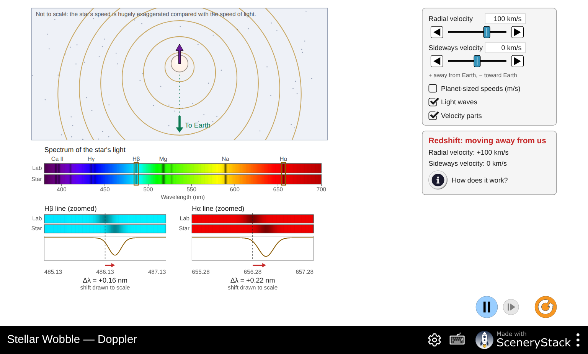
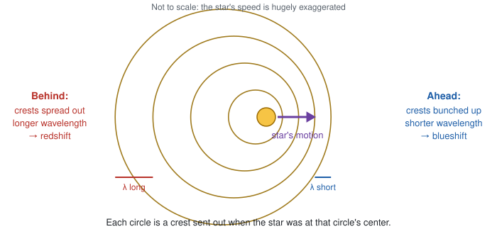
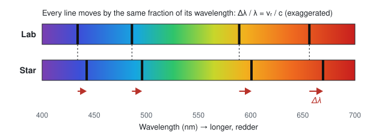
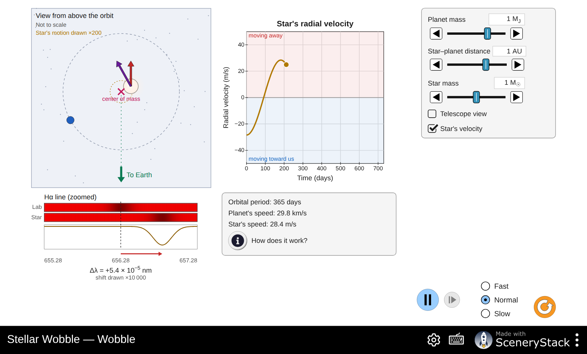
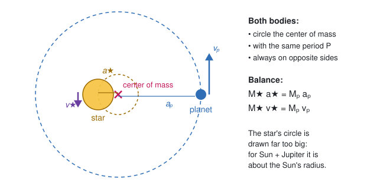
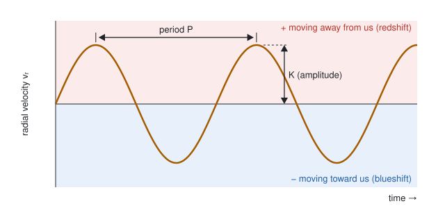
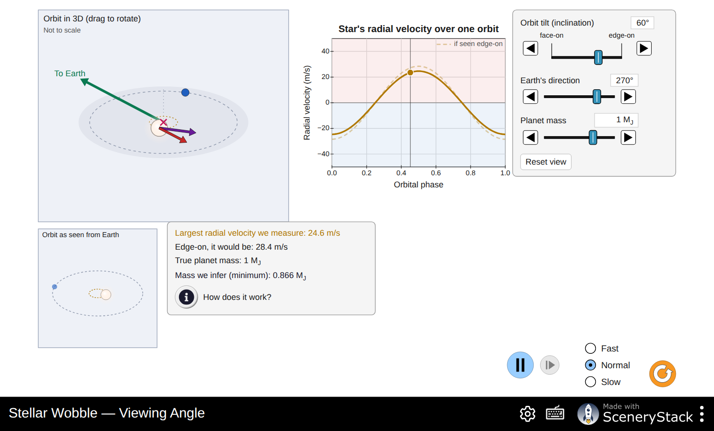
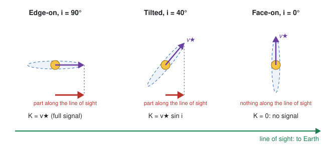
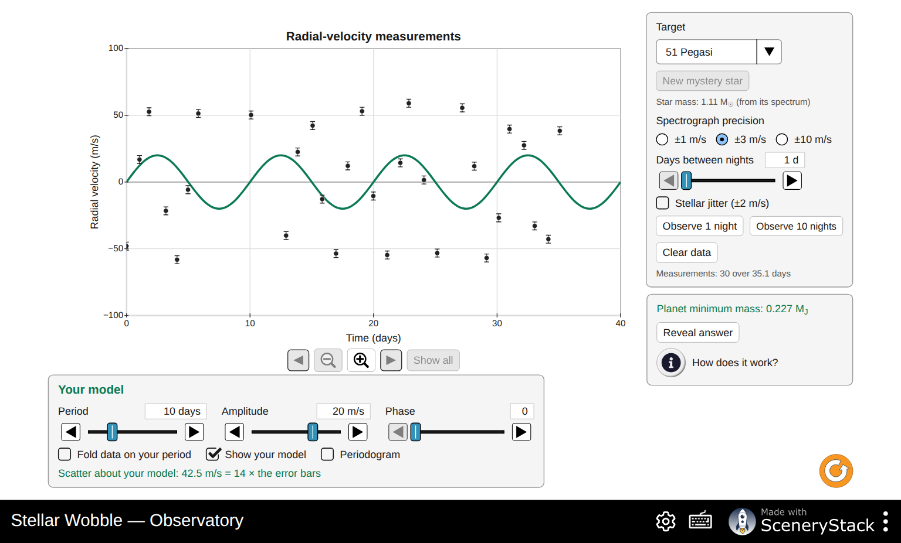
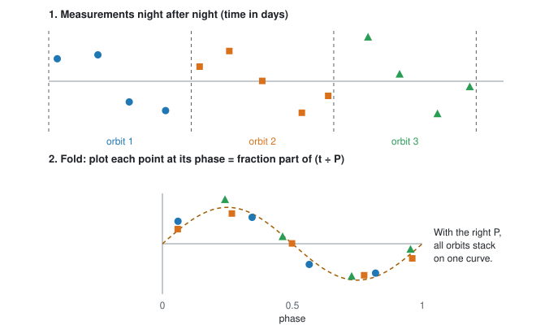

# Stellar Wobble: Weighing a Planet You Cannot See

**Simulation:** Stellar Wobble, <https://openlyceum.github.io/StellarWobble/> (works offline once loaded)

Names: ______________________________________________ Section: ________ Date: __________

## What you will learn

By the end of this activity you should be able to:

1. Explain how the Doppler shift of a star's dark spectral lines tells us how fast the star moves toward or away from us.
2. Explain why a planet makes its star wobble, and predict how the wobble changes with the planet's mass, the size of its orbit and the star's mass.
3. Explain why the tilt of an orbit hides part of the wobble, and why this method gives only a *minimum* mass for the planet.
4. Find the period and minimum mass of a real planet from noisy measurements, the way astronomers do.

Throughout, keep one fact in mind: **we never see the planet.** Everything comes from the star's light.

## Tips for using the simulation

- Each screen has a **How does it work?** button with a short explanation. Use it when you are stuck.
- To set a slider precisely, use the ◀ ▶ buttons beside it, or click the slider and hold **Shift** while pressing the arrow keys for very small steps.
- The orange button (bottom right) resets the screen.
- Leave **Preferences (gear icon) → Simulation → Show equations** off until a question asks for it.
- Record the values you actually set. They do not need to match the suggested values exactly.

---

## Part 0: Predictions

Answer these **before** you open the simulation. You will come back to them at the end. There are no wrong answers here.

**P1.** Astronomers have found thousands of planets around other stars but have taken pictures of very few of them. Why do you think it is so hard to see a planet next to its star?

  

**P2.** A planet orbits a star. Does the star move at all? Explain your thinking.

  

**P3.** Which would make a star wobble more? Circle one in each pair.

- a heavier planet / a lighter planet
- a planet close to its star / a planet far from its star

**P4.** Suppose you look at a planet's orbit from directly above, so the orbit looks like a circle on the sky. Could you detect the planet by measuring how fast its star moves toward or away from you? Explain.

  

---

## Part 1: Doppler (reading a star's speed from its light)

Open the **Doppler** screen. A star sends light waves toward Earth, at the bottom of the picture. Below it, the star's spectrum (the band labeled **Star**) sits under the same spectrum measured in a laboratory on Earth (**Lab**). The dark lines are wavelengths absorbed by atoms in the star's outer layers. Two of them, hydrogen-beta (Hβ, 486.13 nm) and hydrogen-alpha (Hα, 656.28 nm), are zoomed in at the bottom.

**1.** Leave the **Radial velocity** at +100 km/s.

a. Is the star moving toward Earth or away from it? (Read the hint under the sliders.) ______________

b. Look at the waves heading down toward Earth. Are their crests bunched up or spread out compared with the waves going up? ______________

c. In the zoomed windows, do the dark lines move toward shorter or longer wavelengths? Is this a redshift or a blueshift? ______________

**2.** Set each radial velocity in the table and record the shift Δλ of each line (shown under each zoom window), and whether it is a redshift, a blueshift or no shift.

| Radial velocity (km/s) | Δλ of Hβ (nm) | Δλ of Hα (nm) | Redshift, blueshift or none? |
|---|---|---|---|
| +100 | | | |
| +300 | | | |
| −50 | | | |
| −200 | | | |
| 0 | | | |

**3.** Look at your table.

a. For the same speed, which line shifts more: Hβ or Hα? ______________

b. At +100 km/s, calculate Δλ ÷ λ for each line (λ is the line's lab wavelength).

Hβ: Δλ ÷ λ = ______________  Hα: Δλ ÷ λ = ______________

c. Calculate v ÷ c for v = 100 km/s, with c = 300,000 km/s. v ÷ c = ______________

d. What do you notice? Complete the rule in words: "Every line shifts by the same ______________ of its wavelength."

The Doppler formula is

> **Δλ / λ = vᵣ / c**

where vᵣ is the radial velocity: the part of the star's velocity along our line of sight, positive when the star moves away.

**4.** Set **Radial velocity** to 0 and **Sideways velocity** to +200 km/s. Turn on **Velocity parts** if it is off.

a. Do the lines shift? ______________

b. In your own words, why does sideways motion not shift the lines?

  

**5.** Now set **Radial velocity** to +60 km/s and **Sideways velocity** to +150 km/s. The star is now moving at an angle.

a. What radial velocity would an astronomer measure from the spectrum? ______________

b. Could the astronomer find the star's sideways velocity from the spectrum alone? Explain.

  

### Planet-sized speeds

A planet tugs its star at only a few meters per second. Check **Planet-sized speeds (m/s)**.

**6.** Set the **Radial velocity** to +30 m/s.

a. What Δλ does the simulation give for Hα? ______________ nm

b. Check it with the Doppler formula (c = 3.00 × 10⁸ m/s). Show your work.

  

c. Under each zoom window the simulation now prints "shift drawn ×…". What does this mean, and why is it needed?

  

**7.** Jupiter makes the Sun move at about 12.5 m/s.

a. Calculate the shift of the Hα line caused by this motion. ______________ nm

b. Write Δλ ÷ λ as a decimal number. How many zeros come after the decimal point before the first nonzero digit? ______________

c. Press **How does it work?** What do astronomers do to measure such tiny shifts?

  

---

## Part 2: Wobble (a planet makes its star move)

Open the **Wobble** screen. You look down on a star and its planet from above their orbit. Earth is far away toward the bottom of the picture. Start with a 1 M☉ star (one solar mass), a 1 M_J planet (one Jupiter mass) and a distance of 1 AU (the Earth–Sun distance). Press play.

**8.** Watch the motion for a few orbits.

a. Describe how the star moves. Where is the **center of mass** (the × mark)?

  

b. Why is the center of mass so much closer to the star than to the planet?

  

c. Are the star and the planet ever on the same side of the center of mass? ______________

**9.** Watch the chart and the Hα line together.

a. Pause when the star's radial velocity is at its largest **positive** value. Where is the star in its small circle, and which way is it moving relative to Earth?

  

b. Pause when the radial velocity is zero. Which way is the star moving now? Why is there no Doppler shift at this moment?

  

**10.** Record the readouts for the starting settings.

Orbital period: ______________ Planet's speed: ______________ Star's speed: ______________

a. How many times faster than the star does the planet move? (Watch the units!) ______________

b. Jupiter's mass is about 1/1050 of the Sun's mass. Use the balance rule **M★ v★ = Mₚ vₚ** to explain your answer to (a).

  

**11.** Change **one thing at a time**, starting from the original settings each time (press the reset button between rows). Record the period and the star's speed.

| Planet mass (M_J) | Star–planet distance (AU) | Star mass (M☉) | Orbital period | Star's speed (m/s) |
|---|---|---|---|---|
| 1 | 1 | 1 | | |
| about 2 | 1 | 1 | | |
| about 4 | 1 | 1 | | |
| 1 | about 0.25 | 1 | | |
| 1 | about 4 | 1 | | |
| 1 | 1 | 0.5 | | |
| 1 | 1 | 1.5 | | |

**12.** Use your table to describe each pattern.

a. When the planet's mass doubles, the star's speed ______________ and the period ______________.

b. When the planet moves 4 times closer to the star, the star's speed ______________ and the period ______________.

c. When the star is heavier, the star's speed ______________ and the period ______________.

**13.** Check **Telescope view**.

a. What disappears, and what is left? Why is this "all an astronomer gets"?

  

b. Look at the chart and the diagram below. Name the two numbers an astronomer can read from a radial-velocity curve.

1. ______________ 2. ______________

c. From your table, which planet property mostly sets each number?

  

**14.** Our own Solar System.

a. Jupiter orbits the Sun at 5.2 AU. Set the distance to its largest value (5 AU) with a 1 M_J planet and a 1 M☉ star. Star's speed: ______________ m/s

b. Now make an Earth: set the planet mass to its smallest value (about 0.003 M_J, roughly one Earth mass) at 1 AU. Star's speed: ______________ m/s

c. The best spectrographs today measure speeds to about 1 m/s or a little better. Could astronomers on another star detect Jupiter's pull on the Sun? Earth's pull? Explain.

  

**15.** In 1995, the first planet found around a Sun-like star, 51 Pegasi b, turned out to be a "hot Jupiter": a giant planet orbiting very close to its star. Use your results from questions 11–14 to explain why the first planets found with this method were giant planets close to their stars.

  

---

## Part 3: Viewing Angle (where we stand matters)

Open the **Viewing Angle** screen. The top left shows the orbit in 3D, with a green arrow pointing toward Earth (drag the picture to rotate it). The small panel shows the orbit as seen from Earth. The chart compares the radial velocity we measure (solid curve) with what we would measure if we saw the orbit edge-on (dashed curve).

The **orbit tilt**, or inclination *i*, is 90° when we see the orbit edge-on and 0° when we see it face-on.

**16.** Leave the planet mass at 1 M_J. For each tilt, record the readouts and fill in the last two columns.

| Orbit tilt *i* | Largest radial velocity we measure (m/s) | Edge-on, it would be (m/s) | Mass we infer (M_J) | measured ÷ edge-on | sin *i* |
|---|---|---|---|---|---|
| 90° | | | | | |
| 60° | | | | | |
| 30° | | | | | |
| 10° | | | | | |
| 0° | | | | | |

**17.** Compare the last two columns. Write an equation that connects the measured amplitude K, the star's full speed v★ and the tilt *i*.

 

**18.** At a tilt of 0°, what does the screen say? Use the diagram above to explain why the planet is invisible to this method. Was your prediction P4 right?

  

**19.** Set the tilt back to 60°. Change **Earth's direction** to several different values. What changes in the chart, and what stays the same?

  

**20.** Set the tilt to 30° and the **Planet mass** to about 2 M_J.

a. Mass we infer: ______________ M_J

b. Compare with the mass inferred for a 1 M_J planet seen edge-on (your table). Could an astronomer who has only the radial-velocity curve tell these two systems apart? ______________

c. This is why the radial-velocity method gives the planet's mass as **Mₚ sin *i***. Explain why Mₚ sin *i* is a *minimum* mass: can the true mass be smaller than Mₚ sin *i*? Larger?

  

**21.** A planet is announced with Mₚ sin *i* = 0.47 M_J.

a. If its orbit were tilted only 10° from face-on (*i* = 10°), what would its true mass be? ______________ M_J

b. For orbits pointed in random directions, about 87 % have *i* greater than 30°. For most planets, then, the true mass is less than ______________ times Mₚ sin *i*. Is Mₚ sin *i* usually a reasonable estimate?

  

---

## Part 4: Observatory (finding a real planet in noisy data)

Open the **Observatory** screen. Now you are the astronomer. Each night you observe, the spectrograph gives one radial-velocity measurement with an error bar. Some nights are cloudy. Your job is to find the period and amplitude of the star's wobble, then the planet's minimum mass.

### 51 Pegasi, the first planet found around a Sun-like star

Set **Target** to **51 Pegasi**. Keep **Spectrograph precision** at ±3 m/s and **Days between nights** at 1 d. Press **Observe 10 nights** three times.

**22.** Look at the measurements (use the zoom and arrow buttons under the chart to look closely).

a. Do you see a repeating pattern? Estimate the period by eye. ______________ days

b. Estimate the amplitude (the height of the peaks) by eye. ______________ m/s

**23.** Check **Periodogram**. The periodogram tries every period from 1 to 5000 days and shows how much of the scatter in your data a wave of that period explains.

a. Period of the highest peak: ______________ days

b. There is a second, smaller peak at a shorter period. Its period: ______________ days

c. Press **Use highest peak**. The period of your model is now ______________ days.

**24.** The smaller peak is an **alias**. You observe about once a day, so a wave with a period near 1.3 days, sampled once a day, looks almost the same as the real 4.23-day wave.

a. Calculate P ÷ (P − 1) for P = 4.23 days: ______________ days. Compare with your answer to 23b.

b. How could an astronomer show that 4.23 days, not the alias, is the real period? (Hint: what if you could observe several times in one night?)

  

**25.** Uncheck **Periodogram**. Check **Fold data on your period**. The folded chart plots every measurement at its place in the orbit (its phase), as in the diagram above.

a. Do the folded points form one smooth curve? What does this tell you about your period?

  

b. Adjust **Amplitude** and **Phase** until your model curve passes through the folded points. Aim for a **Scatter about your model** close to 1 × the error bars.

| Period (days) | Amplitude K (m/s) | Phase | Scatter (× error bars) |
|---|---|---|---|
| | | | |

c. Why is a scatter of about 1 × the error bars the sign of a good fit? What would a scatter of 5 × the error bars tell you?

  

**26.** Read the **Planet minimum mass**: ______________ M_J. Then press **Reveal answer**.

a. How close were you? ______________

b. 51 Pegasi b orbits its star in about 4.2 days. Mercury, the closest planet to the Sun, takes 88 days. Use Kepler's third law, **P² = a³ / M★** (P in years, a in AU, M★ in solar masses), to find 51 Peg b's distance from its star. The star's mass is shown under the target menu. Show your work.

  

a = ______________ AU

c. Why did many astronomers find this planet surprising in 1995?

  

### Proxima Centauri: does precision matter?

Proxima Centauri, the nearest star to the Sun, has a planet about the mass of Earth. Its wobble is only about 1.2 m/s.

**27.** Press **Clear data**, set **Target** to **Proxima Centauri** and work through the table. For each row, clear the data, observe the given number of nights, then turn on the **Periodogram** and record the period of the highest peak. The true period is 11.2 days.

| Spectrograph precision | Stellar jitter | Nights observed | Period of highest peak (days) | Planet found? |
|---|---|---|---|---|
| ±10 m/s | off | 40 | | |
| ±3 m/s | off | 40 | | |
| ±3 m/s | off | 100 | | |
| ±1 m/s | off | 40 | | |
| ±1 m/s | on | 40 | | |
| ±1 m/s | on | 100 | | |

a. What is the most important factor in finding this planet?

  

b. **Stellar jitter** adds motion from the star's own surface (bubbling gas, spots, oscillations). How does it affect the search? Why can't a better spectrograph remove it?

  

**28.** Set **Target** to **Sun + Earth**, precision ±1 m/s, and observe as many nights as you can (try changing **Days between nights**). Can you find Earth? Use your answer to explain why finding a true "Earth twin" with this method is so hard.

  

### Challenge: a mystery star

**29.** Set **Target** to **Mystery star**. The star's mass is given (astronomers get it from the star's spectrum). Find its planet on your own.

| Star mass (M☉) | Days between nights | Nights observed | Period (days) | Amplitude K (m/s) | Minimum mass (M_J) | Answer revealed |
|---|---|---|---|---|---|---|
| | | | | | | |

Describe your strategy in a few sentences. If the period is long, how did you change the way you observed?

  

---

## Part 5: Putting it together

**30.** Go back to your predictions P1–P4. For each one, say whether you would change your answer, and why.

   

**31.** Which kinds of planets is the radial-velocity method best at finding? Which kinds does it miss? Give at least two reasons, using what you measured today.

  

**32.** A colleague claims to have found a planet with Mₚ sin *i* = 5 Earth masses and a period of 300 days around a Sun-like star. List three reasons why this detection is much harder than 51 Pegasi b.

  

**33.** Some planets also pass in front of their star as seen from Earth (they *transit*), so the star dims a little once per orbit. If a planet transits, what do we know about its orbit tilt? How would that help us find the planet's **true** mass rather than a minimum mass? (You will explore this in the Transit Hunter simulation.)

  
