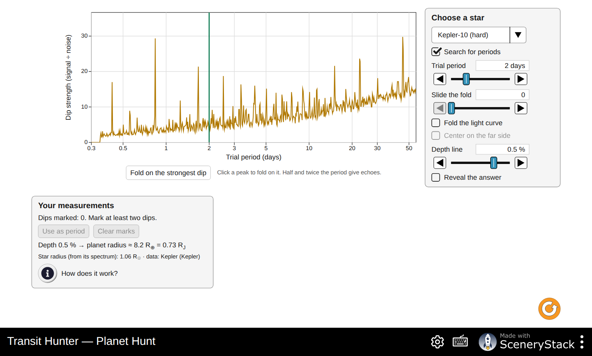
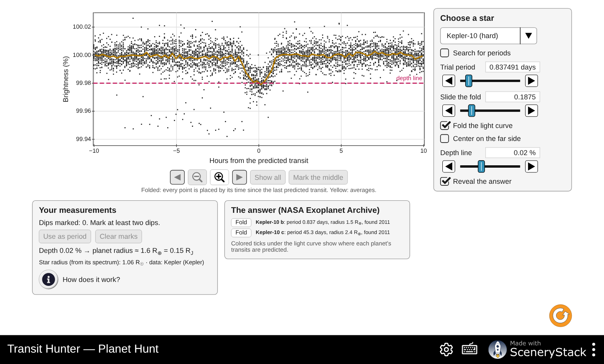

# Transit Hunter: Answer Key and Instructor Notes

For the handout *Transit Hunter: Finding Planets by Their Shadows*. Instructor use only.

The numbers come from the simulation's formulas (`TransitHunter/doc/model.md`), recomputed with
`handouts/tools/answers-transithunter.mjs`, and from its bundled NASA Exoplanet Archive values
(retrieved 2026-11-05). I checked these readouts in the simulation:

- the default Light Curve: depth 1.1 %, 11 R⊕, 4.08 days, 3.2 h, S/N 46 at 1000 ppm;
- Earth at 1 AU with 1000 ppm noise: S/N 6.9 after 88 transits;
- HD 189733 b: the period search gives 2.2183 days;
- Kepler-10 b: a 0.02 % depth gives 1.6 R⊕.

Sliders step coarsely with plain arrow keys (tilt 4.5°, distance ×1.32), so accept values within a few percent.

## Suggested pacing (about 2 hours)

| Part | Time | If short on time |
|---|---|---|
| 0 Predictions | 5 min | Assign as pre-lab |
| 1 Dimming | 15 min | Fill only the Sun-like column of Q2, plus Earth-sized for the red dwarf |
| 2 Lining Up | 20 min | Skip Q11 |
| 3 Light Curve | 20 min | Keep rows 1, 2, 4 and 6 of Q16 |
| 4 Planet Hunt | 35–40 min | HD 189733 and Kepler-10 only; challenge as homework |
| 5 Rock or Gas? | 15 min | Four planets: HD 209458 b, Kepler-7 b, GJ 1214 b, Kepler-10 b |
| 6 Putting it together | 10 min | Q32 and Q33 |

## Part 0: Predictions

- P1: Jupiter-sized about one hundredth (1 %); Earth-sized less than one thousandth (0.008 %). Most students overestimate both.
- P2: far fewer. About 10 % for a hot Jupiter, and about 0.5 % (1 in 200) for an Earth-like orbit.
- P3: its mass (from the star's wobble), and from mass and radius its density.

## Part 1: Dimming

**Q1.** (a) Only while the planet is between us and the star (in front of it). (b) Flat at 100 %. Behind the star the planet blocks none of the light reaching us. (A real hot planet's own glow makes a tiny dip there, which HAT-P-7 shows in Q25.) (c) When the whole planet is on the star's disk. The brightness is lowest and stays flat while the planet is fully inside the disk.

**Q2.** Depth = (R_planet / R_star)². Earth = 1 R⊕, Neptune = 3.88 R⊕, Jupiter = 11.2 R⊕; Sun = 109 R⊕.

| Planet | Star like the Sun | Red dwarf (0.2 R☉) | Big hot star (2 R☉) |
|---|---|---|---|
| Earth-sized | 0.0084 % (1 in 12 000) | 0.21 % (1 in 480) | 0.0021 % (1 in 48 000) |
| Neptune-sized | 0.13 % (1 in 790) | 3.2 % (1 in 32) | 0.032 % (1 in 3 200) |
| Jupiter-sized | 1.1 % (1 in 95) | 26 % (1 in 4) | 0.26 % (1 in 380) |

The simulation rounds these, so "1 part in 11 900" or "12 000" are both fine.

**Q3.** (a) About 125 times. (b) 11.2² ≈ 125: the depth goes as the radius squared. (c) The blocked light is the area of the planet's disk, πR², divided by the area of the star's disk. Areas scale with the square of the radius.

**Q4.** (a) 25 times deeper: the star is 5 times smaller in radius, so the planet covers 5² = 25 times more of its area. (b) Earth-sized planets give dips that are too shallow to see around Sun-like stars without very precise telescopes. Around small red dwarfs the same planet blocks 0.2 %, which much smaller telescopes can detect. (TRAPPIST-1 was found from the ground.)

**Q5.** Only a point of light whose brightness changes. The astronomer measures the brightness over time and nothing else. The planet itself, its color and its shape are invisible.

**Q6.** (a) About 11 R⊕ (√0.01 × 109 = 10.9). (b) √0.0025 × 109 ≈ 5.5 R⊕. A quarter of the depth needs half the radius.

## Part 2: Lining Up

**Q7.** Transit lasts 3.2 h; period 4.08 days; within 5.9° of edge-on; chance 10 %.

**Q8.** Jupiter-sized planet, 0.05 AU, Sun-like star (a/R★ = 10.8; transit lost when the planet passes more than 1.10 star radii from the center):

| Tilt | Passes … star radii from center | Transit lasts | Shape |
|---|---|---|---|
| 90° | 0 | 3.2 h | flat bottom |
| 88° | 0.38 | 3.0 h | flat bottom |
| 86° | 0.75 | 2.4 h | flat bottom, shorter |
| 85° | 0.94 | 1.7 h | V-shaped (grazing) |
| 84° | 1.1 | none | no transit |

**Q9.** At lower tilt the planet crosses the star farther from its center, along a shorter chord, so the transit is shorter. When it passes within a planet radius of the edge, it is never fully on the disk. The blocked area rises and falls without a flat part, which makes the V shape. Past the edge it misses.

**Q10.** Jupiter-sized planet, Sun-like star, tilt 90°:

| Distance | Period | Within … of edge-on | Chance | Duration |
|---|---|---|---|---|
| 0.02 AU | 1.03 d | 14.9° | 26 % | 2.0 h |
| 0.05 AU | 4.08 d | 5.9° | 10 % | 3.2 h |
| 0.1 AU | 11.5 d | 2.9° | 5.1 % | 4.5 h |
| 0.5 AU | 129 d | 0.59° | 1.0 % | 10 h |
| 1 AU | 365 d | 0.29° | 0.51 % | 14 h |
| 2 AU | 1030 d (2.8 yr) | 0.15° | 0.26 % | 20 h |

(a) halves (chance ≈ R★ / a). (b) Planets close to their stars (and large planets, Part 1). (c) Seen from far away, the planet's path covers a band about 2 R★ wide. The band's angular width shrinks as the orbit gets bigger, so fewer random directions fall inside it.

**Q11.** Expected 10 per sky; counts typically range from about 5 to 15 (the standard deviation of a binomial count is √(100 × 0.1 × 0.9) = 3). The average of five skies should be close to 10. (b) Each sky draws 100 random tilts: chance, like flipping coins.

**Q12.** (a) 0.47 %, about 1 in 210. (b) About 700 (150 000 × 0.0047). (c) Only a tiny fraction of planets line up, so to catch even a few you must watch a huge number of stars at once. This is why Kepler stared at about 150 000 stars and TESS surveys most of the sky.

## Part 3: Light Curve

**Q13.** (a) 4.08 days, 1.1 %, 3.2 h. (b) 109 × √0.011 = 11.4 R⊕, which the readout rounds to 11. (c) P = 4.08/365.25 = 0.0112 yr; a³ = 1 × 0.0112² = 1.25 × 10⁻⁴; a = 0.050 AU.

**Q14.**

| Distance | Period | Duration | Depth |
|---|---|---|---|
| 0.05 AU | 4.08 d | 3.2 h | 1.1 % |
| 0.1 AU | 11.5 d | 4.5 h | 1.1 % |
| 0.5 AU | 129 d | 10 h | 1.1 % |

(a) The depth: it depends only on the planet's and the star's sizes. (b) They transit rarely: once every 129 days at 0.5 AU, and once a year at 1 AU. A survey needs years of data to catch several transits, and the chance of lining up is small (Q10).

**Q15.** (a) The bottom of the dip becomes rounded (deepest in the middle) and the edges more gradual. (b) The center of the star is brighter than average, so a planet crossing the middle blocks more than its share of light. The dip is deeper than (R_planet/R_star)², so the radius from √depth comes out too big. Astronomers fit a limb-darkening model to correct for this.

**Q16.**

| Planet | Star | Distance | Noise | Transits | S/N | Verdict |
|---|---|---|---|---|---|---|
| 11 R⊕ | Sun-like | 0.05 AU | 1000 ppm | 1 | 46 | clear |
| 1 R⊕ | Sun-like | 1 AU | 1000 ppm | 1 | 0.7 | lost |
| 1 R⊕ | Sun-like | 1 AU | 1000 ppm | 10 | 2.3 | lost |
| 1 R⊕ | Sun-like | 1 AU | 1000 ppm | about 90 | 7.0 | clear (6.9 at 88) |
| 1 R⊕ | Sun-like | 1 AU | 100 ppm | 1 | 7.4 | clear |
| 1 R⊕ | Red dwarf | 0.05 AU | 1000 ppm | 1 | 6.0 | hint (clear with 2) |

(a) About 90 transits, which takes about 90 years at one transit per year: impossible in practice. (b) About 2 (√4). (c) The air above a ground telescope makes stars twinkle, scattering each measurement by far more than 100 ppm. Only from space can a telescope reach tens of ppm and watch the same stars continuously for years. (d) The dip is 25 times deeper and the period is shorter (9 days), so transits come often.

## Part 4: Planet Hunt

**Q17.** (a) About 11 dips in the 26-day TESS sector (one is lost in the mid-sector gap), each about 2.5 % deep. (b) A dip in the gap is missed. If you simply divided the time span by the number of dips, the period would come out wrong (2.54 days instead of 2.22). The simulation's "repeat every" readout allows for missing dips.

**Q18.** About 2.22 days (archive 2.2186 d; the search gives 2.2183).

**Q19.** Depth about 2.4–2.5 % with R★ = 0.75 R☉, giving about 12.7 R⊕ = 1.13 R_J.

**Q20.** Archive: 2.219 days, 12.7 R⊕. It is a hot Jupiter found by radial velocity in 2005 (Haute-Provence) and one of the most studied exoplanets, at only 20 pc.

**Q21.** Period 4.885 days, depth about 0.75 %, star 1.97 R☉: radius ≈ 18–19 R⊕ ≈ 1.6 R_J (archive 18.2 R⊕). (a) The star is 2.6 times wider than HD 189733 (1.97 vs 0.75 R☉), so the same depth means a planet 2.6 times bigger. A shallower dip on a bigger star can still be a bigger planet. (b) Yes. The dips repeat strictly, so marks before and after a gap still give the period. The marks are numbered by orbit, so missing dips are allowed for.

**Q22.** (a) Three shallow dips (about 0.05 %) near days 13, 59 and 104, about 45 days apart. These belong to Kepler-10 c. Kepler-10 b's dips (0.02 %) are invisible in the raw data.

**Q23.** (a) The strongest peak is near 45 days: Kepler-10 c, the planet seen in Q22. (b) About 0.837 days: Kepler-10 b. (c) Peaks near 0.42 d (half of b), 1.67 d (twice b) and 2.5 d (three times b), and about 22.6 d (half of c).

**Q24.** Depth about 0.02 %, radius about 1.6 R⊕. (a) No. Each dip is smaller than the scatter (about 58 ppm per 30-minute point). Folding stacks about 130 transits, and averaging the stacked points shrinks the scatter by √n, so the 190 ppm dip stands out. (b) 0.837 days = 20.1 hours. (c) Limb darkening (Q15) makes the dip deeper in the middle than (R_planet/R_star)². The archive's 1.47 R⊕ comes from a full model fit. Rounding the depth line to the averages also matters.

**Q25.** Any one:

- **HAT-P-7:** P = 2.205 days, 0.6 % deep, 16.9 R⊕ (star 2.0 R☉). The far-side dip of about 0.007 % (70 ppm) is the secondary eclipse. The planet goes behind its star, so its own light (its glow plus the starlight it reflects) disappears for a few hours. Seeing it means we detected light from the planet itself.
- **Kepler-22:** P ≈ 290 days, so only about five transits fall in four years of data (fewer if some land in gaps). Long periods mean few transits to fold, years of waiting to confirm one, and a lower chance of lining up. Kepler-22 b (2.1 R⊕) was Kepler's first planet in its star's habitable zone (2011).
- **Kepler-11:** six planets with periods of 10.3, 13.0, 22.7, 32.0, 46.7 and 118.4 days. Most students find the two or three deepest (e, d, g). The period search gives d (22.7 d) first.

## Part 5: Rock or Gas?

**Q26.** Masses from the wobble with the transit's tilt (TRAPPIST-1 e from transit timing). The densities are ρ = 5.51 × M/R³ (Earth units).

| Planet | Radius | Mass | Density (g/cm³) | Verdict | Floats? |
|---|---|---|---|---|---|
| HD 209458 b | 15.6 R⊕ (1.4 R_J) | 0.73 M_J (232 M⊕) | 0.34 | gas giant | yes |
| HD 189733 b | 12.7 R⊕ (1.13 R_J) | 1.13 M_J (359 M⊕) | 0.97 | gas giant | yes, barely |
| Kepler-7 b | 18.2 R⊕ (1.6 R_J) | 0.44 M_J (140 M⊕) | 0.13 | gas giant | yes |
| GJ 1214 b | 2.7 R⊕ | 8.4 M⊕ | 2.3 | in between | no |
| Kepler-10 b | 1.47 R⊕ | 3.2 M⊕ | 5.6 | rocky | no |
| 55 Cnc e | 1.9 R⊕ | 8.0 M⊕ | 6.7 | rocky | no |
| TRAPPIST-1 e | 0.92 R⊕ | 0.69 M⊕ | 4.9 | rocky | no |

**Q27.** (a) The wobble measures only the part of the star's motion along our line of sight, M sin i, and the tilt is unknown. (b) A transiting planet must have an orbit tilted close to 90° (86.7° here), so sin i ≈ 1 (0.998) and M sin i ≈ M.

**Q28.** (a) Kepler-10 b sits on the "rock like Earth" curve, between rock and iron. GJ 1214 b sits well above it. (b) A thick envelope of light material: water, or a hydrogen and helium atmosphere. It cannot be bare rock at that size and mass. (JWST shows a hazy, metal-rich atmosphere.)

**Q29.** Transit-timing variations. TRAPPIST-1 has seven planets, which tug on each other, so each one's transits come a few minutes early or late. The size of these shifts gives the planets' masses.

**Q30.** It is strongly heated by its star (at 0.06 AU from a star about 4 times as luminous as the Sun, it receives over 1000 times the starlight Earth does), and this heat can inflate its atmosphere. Tidal heating and its youth also matter. Many hot Jupiters are "inflated" for reasons that are still debated.

## Part 6: Putting it together

**Q31.** P1: about 1 % and 0.008 %. P2: about 10 % for hot Jupiters and 0.5 % for Earth-like orbits. P3: the mass, from the radial-velocity wobble, which gives density.

**Q32.** Best: large planets (deep dips), close to their stars (high chance of lining up, frequent transits) and small stars (deep dips). Misses: small planets around big stars, planets far from their stars (rare transits, low chance of lining up), and orbits that are not nearly edge-on.

**Q33.** Transits give the radius; radial velocity gives the mass (a minimum). Both favor big planets close to their stars, so hot Jupiters were found first by both. With both methods, we get the density and the true mass.

**Q34.** She needs at least two more transits, a year apart each, to confirm the period: at least 2–3 years in total. The dips must have the same depth and shape. She must rule out false positives: an eclipsing binary star in the background, or a grazing eclipse by a star. A radial-velocity measurement (about 9 cm/s for Earth: very hard) or a statistical validation would confirm the planet and its mass. This is why there are thousands of candidates still waiting for confirmation.

## Common misconceptions

- "We see the planet as a dark spot." The star is only a point of light; we only see its brightness drop.
- "Depth is proportional to radius." It goes as the radius squared, an area ratio (Q3).
- "Most planets transit." About 0.5 % of Earth-like orbits do (Q12).
- "A deeper dip means a bigger planet." Only for the same star; the star's size matters (Q21).
- "Noise can't be beaten." Averaging n transits reduces it by √n (Q16, Q24).
- "Low density means a small planet." Gas giants are the least dense (Q26).

## Note on spelling

The simulation's English labels were changed to American spelling on 2026-11-06 (pushed to `main`
and deployed), so the labels quoted in the handout match the live site.

## Model corrections (2026-11-06)

The pure-iron guide now interpolates the numerical Zeng interior-model table; the rocky CMF
fit is not valid for a pure-iron planet. Q28's qualitative rock-versus-envelope conclusions
are unchanged. On the Light Curve screen, coarse bins now average brightness and reduce noise
together. At long periods, a bin wider than a transit dilutes its displayed depth; use the
folded zoom for the depth and the planet-radius inference.
