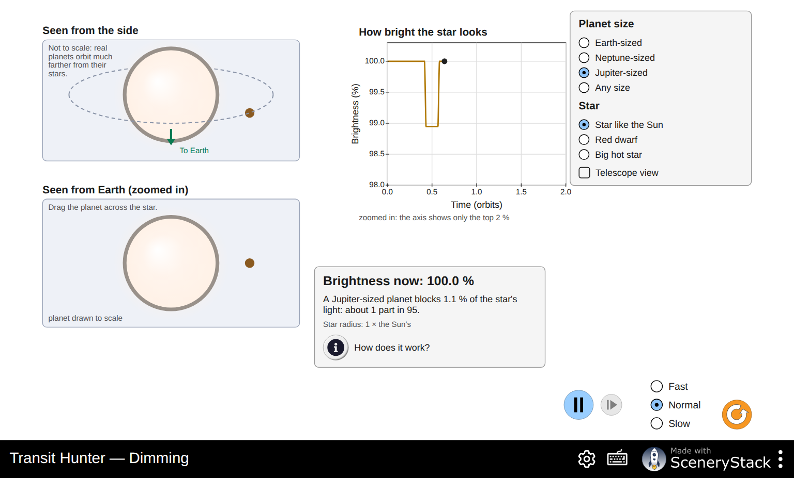
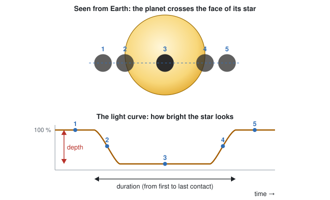
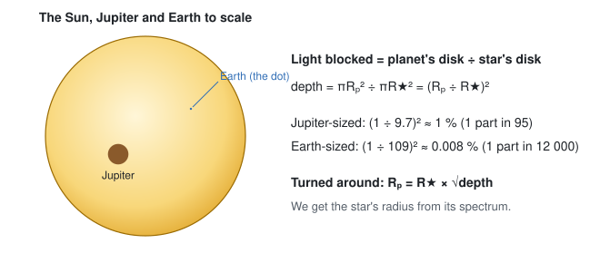
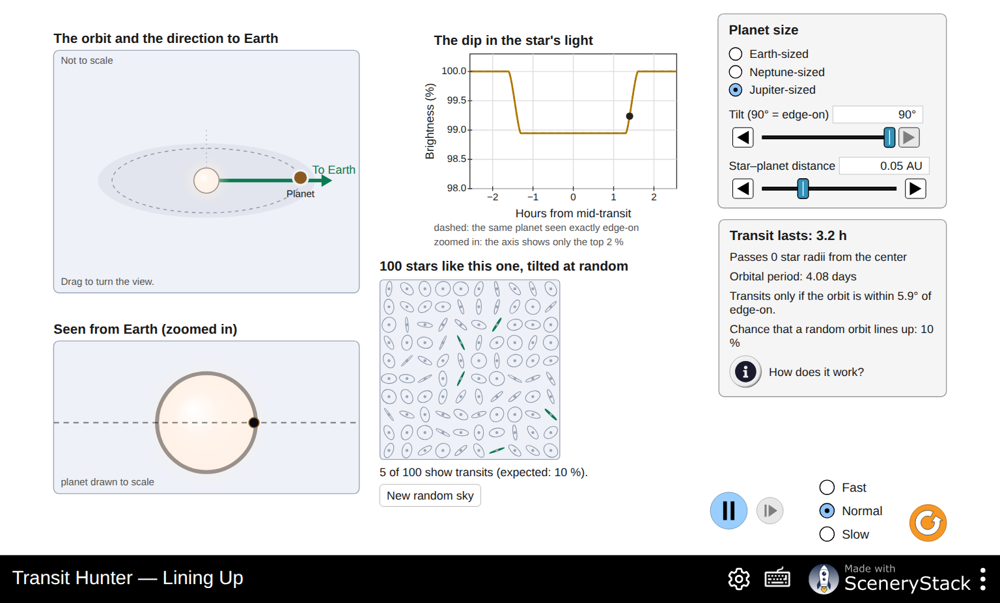
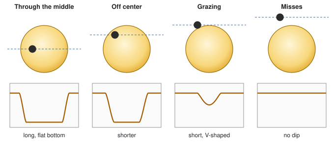
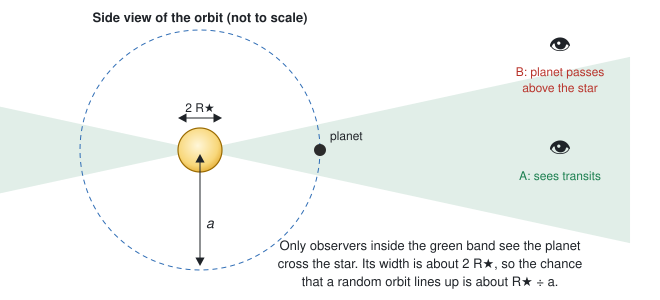
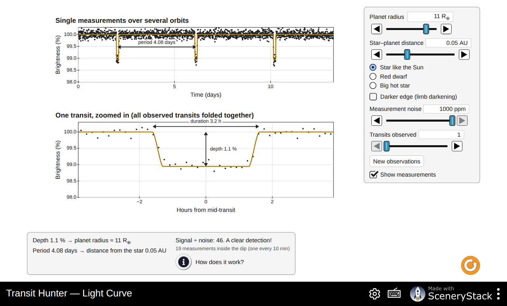
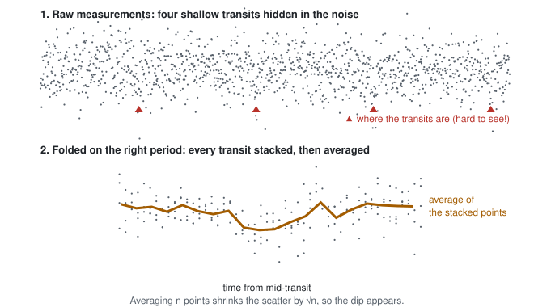
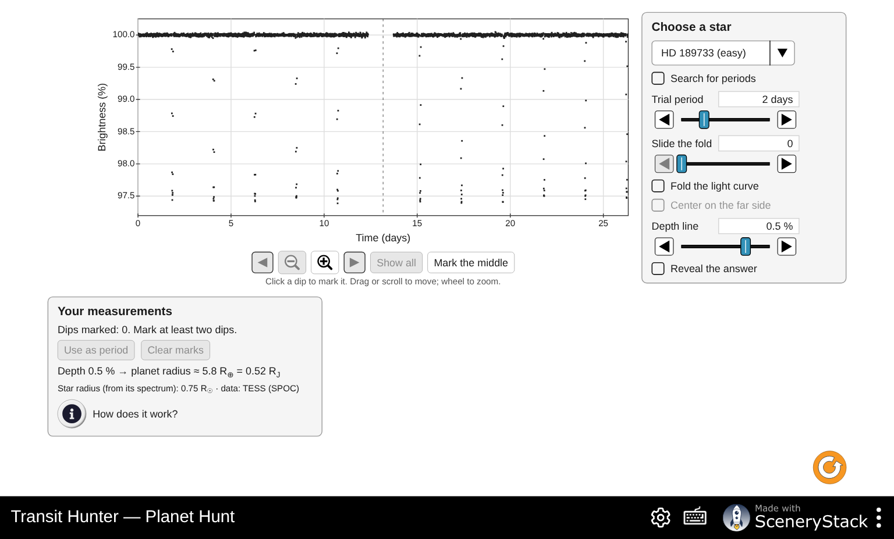
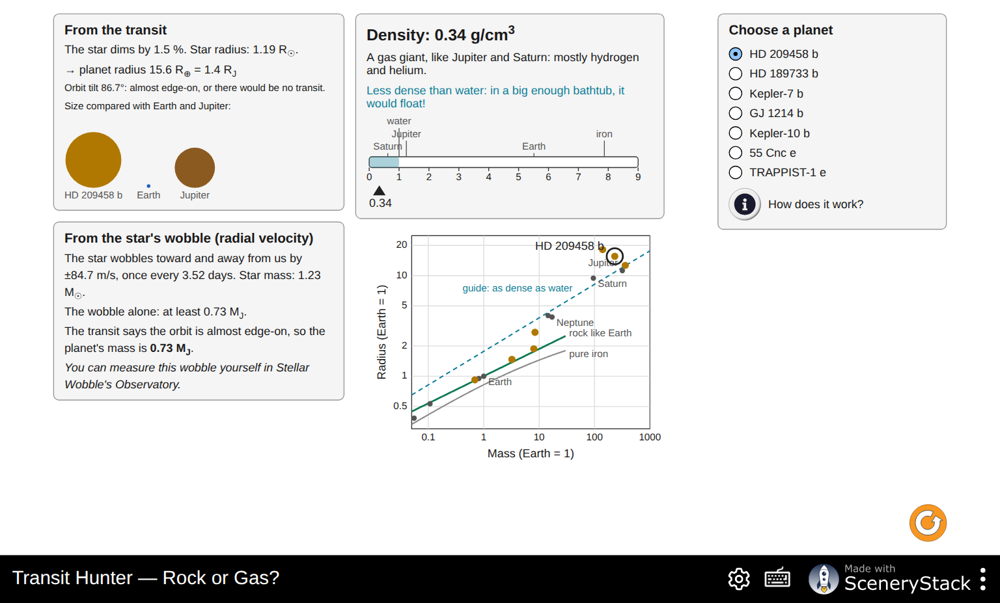

# Transit Hunter: Finding Planets by Their Shadows

**Simulation:** Transit Hunter, <https://openlyceum.github.io/TransitHunter/> (works offline once loaded)

Names: ______________________________________________ Section: ________ Date: __________

## What you will learn

By the end of this activity you should be able to:

1. Explain why a star gets slightly dimmer when a planet passes in front of it, and use the size of the dip to find the planet's size.
2. Explain why only a small fraction of planets pass in front of their stars as seen from Earth, and which planets are most likely to.
3. Read a planet's period, depth and duration from a light curve, and explain how combining many transits beats measurement noise.
4. Find planets in real measurements from NASA's Kepler and TESS space telescopes.
5. Combine a planet's size (from its transit) with its mass (from its star's wobble) to decide whether it is rocky or gaseous.

As with the radial-velocity method, **we never see the planet.** We only measure the star's light.

## Tips for using the simulation

- Each screen has a **How does it work?** button with a short explanation. Use it when you are stuck.
- To set a slider precisely, use the ◀ ▶ buttons beside it, or click the slider and hold **Shift** while pressing the arrow keys. Plain arrow keys make big jumps.
- The orange button (bottom right) resets the screen.
- Record the values you actually set. They do not need to match the suggested values exactly.

---

## Part 0: Predictions

Answer these **before** you open the simulation. You will come back to them at the end.

**P1.** When a planet passes in front of its star, by about how much does the star's brightness drop? Circle one guess for each planet.

- A Jupiter-sized planet in front of a Sun-like star: half / one tenth / one hundredth / less than one thousandth
- An Earth-sized planet in front of a Sun-like star: half / one tenth / one hundredth / less than one thousandth

**P2.** Suppose every star had planets. From Earth, what fraction of those planets would you expect to pass in front of their stars? All / about half / about 1 in 10 / far fewer. Explain.

  

**P3.** A transit tells us how big a planet is. What else would you need to know to decide whether it is a rocky planet like Earth or a gas giant like Jupiter?

  

---

## Part 1: Dimming (why the star gets dimmer)

Open the **Dimming** screen. A planet orbits its star. The top view shows the system from the side, with Earth toward the bottom. The lower view shows what we would see from Earth if we could zoom in on the star. The chart shows how bright the star looks over time. Press play.

**1.** Watch a few orbits.

a. When does the star's brightness drop? ______________

b. What does the chart look like while the planet is behind the star, on the far side of its orbit? Why?

  

c. Drag the planet slowly across the star (lower view). Watch **Brightness now**. When is the star dimmest?

  

**2.** For each planet size and star, record the percent of light blocked and the "1 part in …" number from the readout.

| Planet size | Star like the Sun | Red dwarf | Big hot star |
|---|---|---|---|
| Earth-sized | ______ % (1 in ______) | ______ % (1 in ______) | ______ % (1 in ______) |
| Neptune-sized | ______ % (1 in ______) | ______ % (1 in ______) | ______ % (1 in ______) |
| Jupiter-sized | ______ % (1 in ______) | ______ % (1 in ______) | ______ % (1 in ______) |

**3.** Compare the Jupiter-sized and Earth-sized planets in front of a Sun-like star.

a. How many times more light does the Jupiter-sized planet block? ______________

b. A Jupiter-sized planet is about 11 times wider than an Earth-sized one. How do your numbers in (a) and this factor of 11 relate?

 

c. Explain, using the diagram, why the fraction blocked depends on the **square** of the planet's radius.

  

**4.** Compare an Earth-sized planet in front of a **Red dwarf** with the same planet in front of a **Star like the Sun**.

a. How many times deeper is the dip with the red dwarf? ______________ The red dwarf's radius is 0.2 times the Sun's. Explain the factor.

 

b. Why is this good news for astronomers looking for Earth-sized planets?

  

**5.** Check **Telescope view**. What is left? What can an astronomer actually measure, and what can they not see at all?

  

**6.** Choose **Any size** and a **Star like the Sun**.

a. Adjust the **Planet radius** until the planet blocks about 1 % of the star's light. Radius: ______________ R⊕

b. Predict the radius that blocks about 0.25 % (a quarter as much light): ______________ R⊕. Check it in the simulation: ______________ R⊕

---

## Part 2: Lining Up (why most planets never transit for us)

Open the **Lining Up** screen. The top left shows the orbit in 3D with an arrow toward Earth. The lower left shows the planet's path across the star as seen from Earth. Below the chart, 100 stars like this one have orbits tilted at random. The tilt is 90° when we see the orbit exactly edge-on.

**7.** Keep a **Jupiter-sized** planet at 0.05 AU, seen edge-on (tilt 90°). Record:

Transit lasts: ______________ Orbital period: ______________

Transits only if the orbit is within ______________ of edge-on. Chance that a random orbit lines up: ______________

**8.** Lower the **Tilt** step by step. Record how far from the star's center the planet passes (in star radii), how long the transit lasts and the shape of the dip.

| Tilt | Passes … star radii from the center | Transit lasts (h) | Shape of the dip (flat bottom, V-shaped or none) |
|---|---|---|---|
| 90° | | | |
| 88° | | | |
| 86° | | | |
| 85° | | | |
| 84° | | | |

**9.** Use the diagram to explain why the transit gets shorter as the tilt decreases, and why the dip becomes V-shaped just before it disappears.

  

**10.** Set the tilt back to 90°. Change the **Star–planet distance** and record the chance of a transit and how long the transit lasts.

| Distance (AU) | Orbital period | Transits only if within … of edge-on | Chance that a random orbit lines up | Transit lasts (h) |
|---|---|---|---|---|
| about 0.02 | | | | |
| 0.05 | | | | |
| about 0.1 | | | | |
| about 0.5 | | | | |
| 1 | | | | |
| 2 | | | | |

a. When the distance doubles, the chance of a transit ______________.

b. Which planets are most likely to be found by the transit method?

 

c. Use the diagram to explain the pattern in (a).

  

**11.** Set the distance back to 0.05 AU. Look at the 100 random stars and press **New random sky** four more times.

| Sky | 1 | 2 | 3 | 4 | 5 | Average |
|---|---|---|---|---|---|---|
| Stars that show transits (out of 100) | | | | | | |

a. Compare your average with the expected percentage. ______________

b. Why does the count change from sky to sky?

  

**12.** Choose an **Earth-sized** planet at 1 AU (like Earth).

a. Chance that a random orbit lines up: ______________ % = about 1 in ______________

b. Suppose a telescope watches 150,000 Sun-like stars and every one has an Earth-like planet at 1 AU. About how many would show transits? ______________

c. Use your answers to explain why missions like Kepler and TESS watch hundreds of thousands of stars at once.

  

---

## Part 3: Light Curve (reading a planet's size and orbit)

Open the **Light Curve** screen. The top chart shows single measurements over several orbits. The bottom chart zooms in on one transit, with all observed transits folded on top of each other.

**13.** Start with the original settings: an 11 R⊕ planet at 0.05 AU from a **Star like the Sun**, no noise.

a. Read the period, depth and duration from the charts. Period: ______________ Depth: ______________ % Duration: ______________ h

b. Check the readout "planet radius ≈ …" yourself with **R_planet = R_star × √depth**. The Sun's radius is 109 R⊕. Show your work.

  

c. Check "distance from the star" with Kepler's third law, **a³ = M_star × P²** (a in AU, P in years, M_star in solar masses). Show your work.

  

**14.** Change the **Star–planet distance** to about 0.1 AU, then about 0.5 AU.

| Distance (AU) | Period (days) | Duration (h) | Depth (%) |
|---|---|---|---|
| 0.05 | | | |
| about 0.1 | | | |
| about 0.5 | | | |

a. Which quantity does **not** change with distance? Why?

 

b. Planets far from their stars give longer transits, yet they are harder to find. Why?

  

**15.** Check **Darker edge (limb darkening)**. Real stars look darker near their edges.

a. How does the shape of the dip change?

 

b. Read the note under the readouts. Why does a darker edge make the radius from the depth come out a little too big?

  

Now uncheck **Darker edge (limb darkening)**.

### Noise and folding

Real measurements scatter. The **Measurement noise** is the typical scatter of one measurement, in parts per million (ppm): 1000 ppm = 0.1 %.

**16.** Fill in the table. Use **Transits observed** to stack more transits. **Signal ÷ noise** above 7 counts as a clear detection.

| Planet | Star | Distance | Noise (ppm) | Transits observed | Signal ÷ noise | Verdict |
|---|---|---|---|---|---|---|
| 11 R⊕ | like the Sun | 0.05 AU | 1000 | 1 | | |
| 1 R⊕ | like the Sun | 1 AU | 1000 | 1 | | |
| 1 R⊕ | like the Sun | 1 AU | 1000 | 10 | | |
| 1 R⊕ | like the Sun | 1 AU | 1000 | fewest for "clear detection": ______ | | |
| 1 R⊕ | like the Sun | 1 AU | 100 | 1 | | |
| 1 R⊕ | Red dwarf | 0.05 AU | 1000 | 1 | | |

a. For the Earth-like planet with 1000 ppm noise, how many transits did you need? How many **years** of observing is that?

 

b. Stacking 4 times as many transits improves the signal ÷ noise by a factor of about ______________. (Check it in the simulation.)

c. The Kepler space telescope measured bright stars to about 30 ppm over a few hours. Why did finding Earth-sized planets need a telescope in space?

  

d. Why are planets around red dwarfs much easier to detect (last row)?

  

---

## Part 4: Planet Hunt (real data from Kepler and TESS)

Open the **Planet Hunt** screen. These are real measurements of real stars. Each dot is the star's brightness at one moment.

How to hunt:

1. Zoom and scroll with the buttons under the chart (or drag the chart and use the mouse wheel).
2. Click on dips to mark them. The panel tells you how often they repeat. Press **Use as period**.
3. Check **Fold the light curve**. If the period is right, all the dips land on top of each other. Use **Slide the fold** to center the dip.
4. Drag the **Depth line** (or use its slider) to the bottom of the folded dip. The panel turns the depth into the planet's radius.
5. Only then check **Reveal the answer**.

### HD 189733 (easy, TESS)

**17.** Look at the whole light curve.

a. How many dips can you see? ______________ How deep are they, roughly? ______________ %

b. The dashed line in the middle marks a gap in the data. TESS stops observing for about a day in the middle of each 27-day sector to send its data to Earth. What could go wrong if a dip falls in the gap?

  

**18.** Mark at least three dips and press **Use as period**. Then fold and slide the fold to center the dip.

Period: ______________ days

**19.** Set the **Depth line** at the bottom of the folded dip.

Depth: ______________ % Planet radius: ______________ R⊕ = ______________ R_J

**20.** Check **Reveal the answer**. How close were your period and radius? This planet was first found by the radial-velocity method in 2005. Its transits were found soon after.

 

### Kepler-7 (medium, Kepler)

**21.** Choose **Kepler-7**. Find the period, depth and radius the same way.

Period: ______________ days Depth: ______________ % Radius: ______________ R⊕ = ______________ R_J

a. Kepler-7's dips are shallower than HD 189733's, yet its planet is bigger. How can that be? (Look at the star's radius under the panel.)

  

b. Some dips fall into gaps in the data. Does your period still come out right? Why?

  

### Kepler-10 (hard, Kepler)

**22.** Choose **Kepler-10** and look at the whole light curve (zoom in on the brightness axis if needed).

a. Can you see any dips? How many, and how far apart in time?

  

**23.** Check **Search for periods**. The computer folds the light curve on thousands of trial periods and plots how strong the best dip is for each one.

a. Period of the strongest peak: ______________ days. Is this the planet you saw in question 22? ______________

b. Find the next strongest peak at a **short** period. Period: ______________ days. Click it to fold on it.

c. The hint under the chart says that half and twice a planet's period also give peaks ("echoes"). Which other peaks could be echoes?

  

**24.** Fold on the short-period planet and set the depth line at the bottom of the averaged dip (the yellow line).

Depth: ______________ % Radius: ______________ R⊕

a. Could you see this planet's dips in the raw data? Explain how folding made it visible.

  

b. Reveal the answer. This is Kepler-10 b, Kepler's first rocky planet (2011). How long is its year, in hours? ______________

c. Your radius is probably a little bigger than the archive's. Give one reason (hint: question 15).

  

### Challenge (choose one)

**25.** Pick **one** of these and describe what you did and found.

- **HAT-P-7 (easy, Kepler):** find its planet and fold on it, then check **Center on the far side** (half an orbit after the transit). The averages dip by about 0.007 %. What is this dip? (Read **How does it work?**)
- **Kepler-22 (hard, Kepler):** four years of data, very few transits. Find the planet's period. Why does a long period make a planet hard to find and to confirm?
- **Kepler-11 (challenge, Kepler):** six planets around one star. How many can you find?

   

---

When many observations are combined into one displayed point, both brightness and noise are averaged. A bin wider than a transit makes the observed dip shallower; the folded zoom helps resolve its shape.

## Part 5: Rock or Gas? (putting size and mass together)

Open the **Rock or Gas?** screen. For each planet, the transit gives the radius and the star's wobble (radial velocity) gives the mass. The density then tells us what the planet is made of.

**26.** Choose each planet in turn and fill in the table.

| Planet | Radius (R⊕) | Mass (M⊕ or M_J) | Density (g/cm³) | Verdict (rocky, in between, gas giant) | Would it float? |
|---|---|---|---|---|---|
| HD 209458 b | | | | | |
| HD 189733 b | | | | | |
| Kepler-7 b | | | | | |
| GJ 1214 b | | | | | |
| Kepler-10 b | | | | | |
| 55 Cnc e | | | | | |
| TRAPPIST-1 e | | | | | |

For comparison: water 1 g/cm³, rock about 3 g/cm³, Earth 5.5 g/cm³, iron about 8 g/cm³.

**27.** Read the **From the star's wobble** panel for HD 209458 b.

a. The wobble alone gives "at least" a mass. Why only a minimum? (Recall the Stellar Wobble activity.)

 

b. Why does the transit turn this minimum into the true mass?

  

**28.** Kepler-10 b and GJ 1214 b.

a. Where does each sit on the mass–radius diagram compared with the "rock like Earth" curve?

 

b. GJ 1214 b has about the same mass as 55 Cnc e but is much bigger. What must GJ 1214 b have that 55 Cnc e lacks?

  

**29.** TRAPPIST-1 e's star wobbles too little to measure. How do astronomers find its mass instead? (Read the panel.)

  

**30.** Kepler-7 b has a lower density than Saturn, the least dense planet in our Solar System. Kepler-7 b orbits its star in under 5 days. Suggest why a giant planet so close to its star might be "puffed up".

  

---

## Part 6: Putting it together

**31.** Go back to your predictions P1–P3. For each one, say whether you would change your answer, and why.

   

**32.** Which planets is the transit method best at finding? Which does it miss? Give at least three reasons, using what you measured today.

  

**33.** Compare the transit method with the radial-velocity method (Stellar Wobble). Which planet property does each one measure? Which kinds of planets do **both** methods favor?

  

**34.** An astronomer finds a single 0.01 % dip in a Sun-like star's light. Describe what she must do before she can announce an Earth-sized planet in the habitable zone (period about one year). Think about how many transits she needs, how long that takes, and what other measurement would confirm it is a planet.

  
